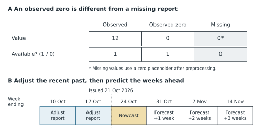
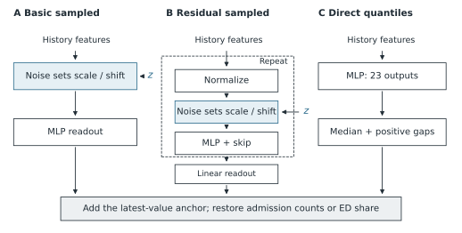

# Challenges and architecture

A surveillance history contains measurements of an epidemic and traces of the
system reporting it. Chromantis uses that history to predict hospital admissions
and emergency-department (ED) visit shares. The method has to account for late
reports, gaps and a short training record before it can say much about the future.

The five sections below explain how those problems shape the models. Examples
of released models refer to **24 October 2026**: those models trained on
2022–23 through 2025–26 and predicted outcomes in 2026–27. The
[model reference](reference/model-details.md) gives their training treatments,
labels, layers and settings. The [submission log](submissions.md) records the
model used for each later forecast.

## Challenge 1: the newest reports are incomplete

Hospitals often add admissions to a week after its first report. A model that
has learned only from revised histories can mistake the low end of a preliminary
report for an epidemic decline. Chromantis addresses this problem both when
preparing training examples and when issuing forecasts.

The weekly flu and RSV models first estimate revisions to the two newest
observed admission and ED weeks. Small gradient-boosted tree models produce
these estimates. A neural model reads the adjusted history and predicts the
current week and three subsequent weeks.

A forecast issued on Wednesday 21 October uses reports through Saturday
17 October. The trees adjust observed values for 10 and 17 October; the neural
model predicts weeks ending 24 October through 14 November. The Hub labels
those four prediction weeks as horizons 0–3. The first prediction is a nowcast
of an unreported week. The revision estimates concern weeks already reported.

### Preparing training histories

The revised epidemic record covers more seasons than the archive of preliminary
reports. Chromantis extends the training examples by applying reporting errors
from archived releases to revised histories. It selects error windows with
similar recent levels and growth, preserving aligned errors across signals and
locations. Each example keeps its own epidemic trajectory and future prediction
labels.

For the weekly flu release, reporting errors from 2025–26 make admission and ED
training histories preliminary throughout 2022–23 to 2025–26. Two sampled-model
configurations train on those histories after correction by cross-fitted trees.
The direct-quantile configuration trains on the uncorrected preliminary
histories and also learns reference values for four recent history weeks as
auxiliary labels. All three receive tree-adjusted reports at issuance. One RSV
configuration uses actual archived histories at eligible dates and artificial
histories elsewhere.

Cross-fitting excludes reference labels inside an example's history window
when training the trees that correct it. Each fit also saves trees for use on
new reports. Those trees supply one adjusted history per fit. The resulting
forecast uncertainty is conditional on that adjustment; it does not include a
sampled range of possible reporting revisions. Missing observations retain their
missing status.

## Challenge 2: missing data is different from zero

Zero admissions and an absent report carry different information. Chromantis
passes an availability indicator alongside every input value. The indicator is
1 for an observed value, including zero, and 0 for a missing value. Missing
values receive a numerical placeholder of zero after preprocessing.

| Recorded observation | Availability | How the model treats it |
|---|---:|---|
| Zero admissions | 1 | An observed outcome of zero |
| A preliminary count of 80 | 1 | A report that may be revised |
| No report | 0 | An unavailable observation, with a zero placeholder |

Training labels have their own availability indicators. An example can have a
preliminary input and a later reference label for the same week. A missing future
label contributes no training loss. The distinction lets models learn from
partial histories without treating unknown outcomes as zero.

Coverage determines how much evidence each outcome supplies. The RSV releases
exclude admission inputs and labels before 2 November 2024, when reporting was
voluntary. RSV ED histories begin in October 2022. The nominal four-season
training period therefore contains fewer than four seasons of admission labels.
The loss weights account for the labels available in each season.

### Gaps in the report archive

A missing archived report can mean either that the source did not publish a
value or that the archive failed to retain it. The standard reported-input
builder cannot resolve that distinction. Where the assumed publication schedule
permits an observation, it fills an archive gap from the later reference panel
and records the substitution. Retrospective models can therefore receive values
that the original forecaster never saw.

The season-peak route uses archived reports without this fallback. It requires
observations for past weeks inside the peak window to calculate the peak so far.
Artificial reporting histories preserve genuine gaps, but the submitted
configurations do not add publication gaps from their donor windows. Their
training treatment simulates revisions to values. Performance during extended
outages needs its own evaluation.

The [data guide](data/index.md) documents the assumed publication schedules.
The [availability staircase](data/staircase.md) shows the reporting evidence
behind them.

## Challenge 3: learning from only a few epidemic seasons

Four seasons provide many weekly observations but few independent epidemics.
Chromantis shares neural-network weights across locations, allowing one state's
examples to help train a forecasting rule used in another. Each configuration
selects its input signals: a model may read its pathogen's admissions and ED
histories, all six respiratory histories, or another set defined by the problem.

The released MLP models use two encoders. Each encoder compresses its inputs
into learned numerical features. The target-history encoder reads one outcome's
values and availability indicators, with weights shared across targets and
locations. The context encoder reads all selected signals at that location,
plus enabled features such as calendar timing, population, recent changes and
summaries of other surveillance sources.

The decoder combines these features with the target identity and forecast week.
Some configurations add context from nearby states. It predicts a change from
the latest available transformed target value, then converts the result back
to admission counts or ED proportions. The
[layer diagram](reference/model-details.md#inside-a-sampled-model) expands one
sampled flu network; the
[input diagram](reference/model-details.md#inputs-and-outputs) follows the actual
21 October reports through the model.

Flu, RSV, season peaks and local ED forecasts have separate fitted weights.
The United States series is also a separate prediction, so national forecasts
can differ from the sum of state forecasts. Experiments can select other
encoders or spatial connections through the scenario settings.

## Challenge 4: describing a range of possible futures

A point forecast gives a likely outcome without expressing how far the outcome
might fall from it. Chromantis learns a predictive distribution using either
generated samples or direct quantile predictions.

A sampled model turns a random draw into one possible future. Repeated draws
produce the distribution used to calculate medians and intervals. Shared
randomness links weeks, targets and locations within a future; some
configurations add local random draws. A direct-quantile model predicts 23
probability levels for each outcome, location and week. It builds ordered
quantiles from a median and positive gaps on either side.

Sampled models learn from future reference outcomes by minimizing the fair
continuous ranked probability score (CRPS). Direct-quantile models minimize
quantile loss. Both objectives reward accurate distributions and account for
spread. Models can also include losses for log admissions, entire paths or
peaks. The [training reference](reference/model-details.md#training-losses-and-weights)
gives the equations and weights.

### Combining fitted distributions

The 24 October weekly flu release combines three configurations with ten fits
per configuration. RSV combines four configurations with ten fits each. Each
fit uses a different random seed. The release gives equal weight to each
configuration and seed, pooling their predictive distributions before deriving
the submitted quantiles.

A distribution for each week does not specify how the weeks move together.
The RSV submission constructs 200 paths, 50 per configuration, using sampled
models' rank patterns to arrange values from the quantile models. Each path
identifier connects weeks and targets within one location. It does not identify
one shared national future.

A separate six-seed flu model produces season-long paths for peak size and week.
Its peak calculation retains reported past admissions as fixed values. The
local ED submission joins a four-week model to a longer model by pairing paths
with the same rank at week 3. That join preserves the predicted values and can
introduce a jump. Decisions involving simultaneous peaks or total national
demand need evidence about these joint predictions as well as individual
weekly intervals.

## Challenge 5: knowing what a comparison actually measures

A retrospective score depends on more than the forecasting model. Training on
later seasons, receiving revised inputs and selecting among many candidates
can all affect the result. A useful comparison tells the reader which of these
conditions applies.

Chromantis distinguishes fitting from replay. Fitting learns weights from the
permitted training data and labels. Replay gives a saved model different
evaluation inputs while retaining those weights. Weekly production runs also
retain saved weights and read new operational reports.

The researcher sets the data, labels, splits and score. A large language model
(LLM) can propose candidate changes and use measured scores to suggest the next
round. Code fits the models and calculates the scores. Repeated use of the same
seasons makes those seasons part of model selection. Additional seeds measure
variation from training randomness; they do not provide new epidemic seasons.

### Training seasons and reporting evidence

Leave-one-season-out evaluation trains on the other permitted seasons. Among
2022–23 through 2025–26, a model evaluated on 2024–25 can train on 2025–26.
A forward evaluation trains only on data preceding the evaluation period.
The [fitting diagram](reference/model-details.md#fitting-and-model-selection)
shows the evaluation seasons and the separate validation weeks used to choose
the training duration.

Reporting-error calibration has its own data boundary. A model can exclude
2025–26 epidemic outcomes from neural training while still using that season's
reporting errors to prepare inputs. A comparison with those prescribed errors
measures performance under the assumed reporting process. Archive fills add a
further difference from forecasts made with the information available at the
time. Both choices belong beside the reported scores.

### Reading scores {#103-metrics}

Weighted interval score (WIS) balances interval width against the distance of
observations outside the intervals. Lower is better. Admission-count WIS
emphasizes absolute errors; WIS after `log(1 + admissions)` gives more weight
to relative errors at low burdens. ED WIS uses proportions. A model can improve
one of these scores while worsening another.

Ensemble-relative WIS divides the model's score by the Hub ensemble's on matched
tasks. A value of 1 means equal performance; a value below 1 favors the model.
The Hub's pairwise ranking uses another calculation. The
[evaluation protocol](workflow.md#standard-evaluation) defines the task sets
and aggregation for each score.

The [experiment reports](experiments/index.md) provide the evidence for choosing
models: scores by outcome, season and horizon, interval coverage and forecasts.
Each result should identify the model, its training seasons and input treatment,
its prediction labels, and its evaluation inputs and season. Those details let
a reader decide how well the comparison answers their question.
