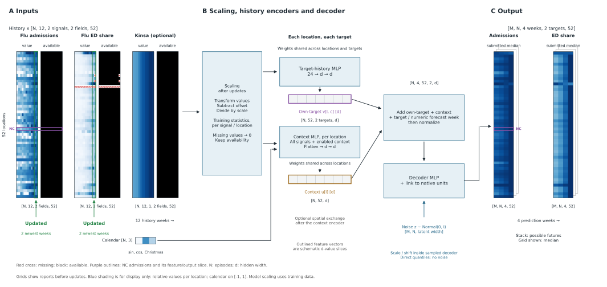
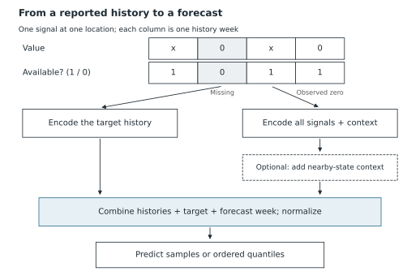
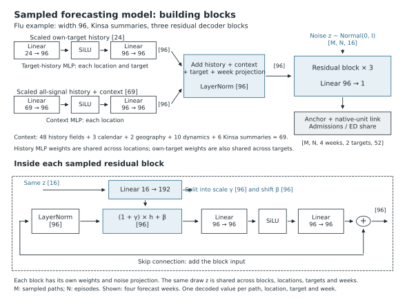
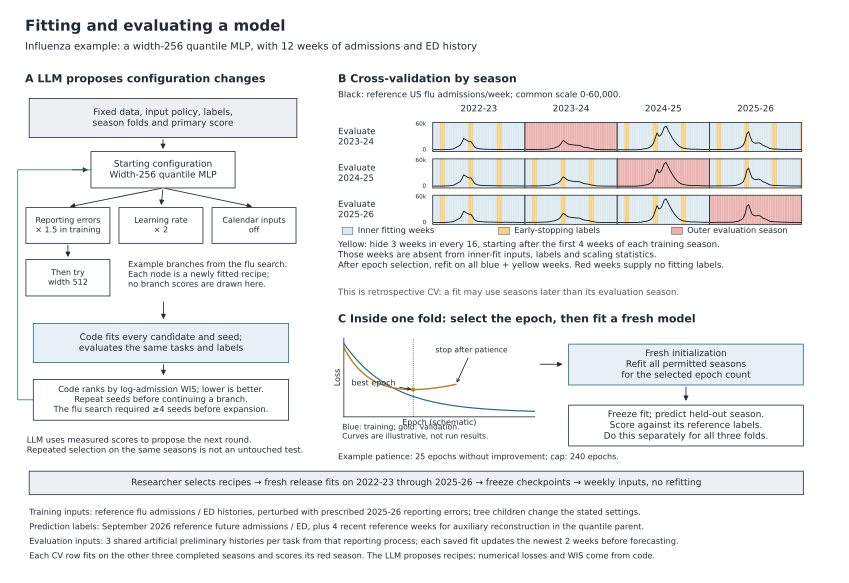
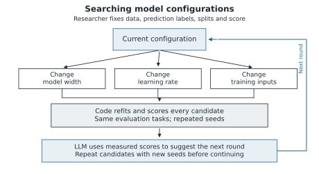

# Architecture

Chromantis reads weekly surveillance histories, estimates revisions to recent
reports and predicts distributions of future admissions and emergency-department
(ED) visit shares. Neural models share learned patterns across locations and
signals. Separate fitted models serve weekly state forecasts, local ED
forecasts and influenza season peaks.

The sections below follow the data through the network, training, evaluation
and forecast export. The diagrams and release tables describe the models used
for **24 October 2026**, trained on 2022–23 through 2025–26 to forecast 2026–27.
The [challenge pages](challenges/index.md) records subsequent releases and issuances.
Click any figure to open the full-size SVG.

A *configuration*, called a recipe in release files, specifies the inputs,
network and training procedure. Training it with one random seed produces a
*fit*. A *release* fixes the fits, preprocessing, correction models and
combination rule used to issue forecasts.

## Inputs and outputs

[](figures/chromantis/shapes.svg)

The diagram follows reports available on 21 October 2026 through a weekly flu
model. The input contains 12 history weeks, two target signals and 52 locations.
Kinsa supplies an optional national influenza-like illness series, copied across
locations with its availability indicator. Calendar features are broadcast to
locations. The purple outlines trace North Carolina admissions.

The input grids show reports before correction trees adjust the two newest
observed admission and ED weeks. The output grids show medians submitted for
24 October, with stacked outlines representing multiple possible futures.
Feature-vector cells are schematic. The shading scales values within each
location for display; training uses its own fixed normalization.

The submitted forecast combines ten fits of each of three flu configurations.
They trained on 2022–23 through 2025–26, with admission and ED input histories
made preliminary using 2025–26 reporting errors. Their future labels were
reference admissions and ED shares from the September 2026 panel. The saved
models read the new reports without retraining. The diagram contains no scored
2026–27 outcomes.

### Missing observations

Zero admissions and an absent report carry different information. Chromantis
passes an availability indicator alongside every input value. The indicator is
1 for an observed value, including zero, and 0 for a missing value. Missing
values receive a numerical placeholder of zero after preprocessing.

| Recorded observation | Availability | How the model treats it |
|---|---:|---|
| Zero admissions | 1 | An observed outcome of zero |
| A preliminary count of 80 | 1 | A report that may be revised |
| No report | 0 | An unavailable observation, with a zero placeholder |

Training labels have their own availability indicators. An example can have a
preliminary input and a later reference label for the same week. A missing future
label contributes no training loss. The distinction lets models learn from
partial histories without treating unknown outcomes as zero.

Coverage determines how much evidence each outcome supplies. The RSV releases
exclude admission inputs and labels before 2 November 2024, when reporting was
voluntary. RSV ED histories begin in October 2022. The nominal four-season
training period therefore contains fewer than four seasons of admission labels.
The loss weights account for the labels available in each season.

### Gaps in the report archive

A missing archived report can mean either that the source did not publish a
value or that the archive failed to retain it. The standard reported-input
builder cannot resolve that distinction. Where the assumed publication schedule
permits an observation, it fills an archive gap from the later reference panel
and records the substitution. Retrospective models can therefore receive values
that the original forecaster never saw.

The season-peak route uses archived reports without this fallback. It requires
observations for past weeks inside the peak window to calculate the peak so far.
Artificial reporting histories preserve genuine gaps, but the submitted
configurations do not add publication gaps from their donor windows. Their
training treatment simulates revisions to values. Performance during extended
outages needs its own evaluation.

The [data guide](data/index.md) documents the assumed publication schedules.
The [availability staircase](data/staircase.md) shows the reporting evidence
behind them.

## Reporting revisions

Hospitals often add admissions to a week after its first report. A model that
has learned only from revised histories can mistake the low end of a preliminary
report for an epidemic decline. Chromantis addresses this problem both when
preparing training examples and when issuing forecasts.

The weekly flu and RSV models first estimate revisions to the two newest
observed admission and ED weeks. Small gradient-boosted tree models produce
these estimates. A neural model reads the adjusted history and predicts the
current week and three subsequent weeks.

[](figures/chromantis/information.svg)

A forecast issued on Wednesday 21 October uses reports through Saturday
17 October. The trees adjust observed values for 10 and 17 October; the neural
model predicts weeks ending 24 October through 14 November. The Hub labels
those four prediction weeks as horizons 0–3. The first prediction is a nowcast
of an unreported week. The revision estimates concern weeks already reported.

### Preparing training histories

The revised epidemic record covers more seasons than the archive of preliminary
reports. Chromantis extends the training examples by applying reporting errors
from archived releases to revised histories. It selects error windows with
similar recent levels and growth, preserving aligned errors across signals and
locations. Each example keeps its own epidemic trajectory and future prediction
labels.

For the weekly flu release, reporting errors from 2025–26 make admission and ED
training histories preliminary throughout 2022–23 to 2025–26. Two sampled-model
configurations train on those histories after correction by cross-fitted trees.
The direct-quantile configuration trains on the uncorrected preliminary
histories and also learns reference values for four recent history weeks as
auxiliary labels. All three receive tree-adjusted reports at issuance. One RSV
configuration uses actual archived histories at eligible dates and artificial
histories elsewhere.

Cross-fitting excludes reference labels inside an example's history window
when training the trees that correct it. Each fit also saves trees for use on
new reports. Those trees supply one adjusted history per fit. The resulting
forecast uncertainty is conditional on that adjustment; it does not include a
sampled range of possible reporting revisions. Missing observations retain their
missing status.

### Generating preliminary histories

The generator applies an archived revision pattern to a recipient history.
The recipient keeps its epidemic trajectory and future labels. Under the
log-ratio method, an error measured in a donor window changes a recipient value
as follows:

```text
error = log((donor_report + donor_floor) / (donor_reference + donor_floor))
preliminary = max(0, (recipient_reference + recipient_floor)
                     * exp(error_strength * error) - recipient_floor)
```

Each floor is the larger of 5% of the relevant season/location/signal peak and
one admission or 0.0001 for a proportion. The floors stabilize ratios near zero;
proportions are also bounded above by one.

The `synchronous_phase_log` generator matches donors by recent relative levels
and two-week log changes. It samples among eight nearby eligible windows,
favoring closer matches. A common donor date retains aligned errors across
locations and signals where observed. Genuine missing cells remain missing.
The submitted configurations transfer value revisions without adding donor
publication gaps.

## Neural network

Four seasons provide many weekly observations but few independent epidemics.
Chromantis shares neural-network weights across locations, allowing one state's
examples to help train a forecasting rule used in another. Each configuration
selects its input signals: a model may read its pathogen's admissions and ED
histories, all six respiratory histories, or another set defined by the problem.

[](figures/chromantis/network.svg)

The released multilayer perceptron (MLP) models use two encoders. Each encoder compresses its inputs
into learned numerical features. The target-history encoder reads one outcome's
values and availability indicators, with weights shared across targets and
locations. The context encoder reads all selected signals at that location,
plus enabled features such as calendar timing, population, recent changes and
summaries of other surveillance sources.

The decoder combines these features with the target identity and forecast week.
Some configurations add context from nearby states. It predicts a change from
the latest available transformed target value, then converts the result back
to admission counts or ED proportions.

Flu, RSV, season peaks and local ED forecasts have separate fitted weights.
The United States series is also a separate prediction, so national forecasts
can differ from the sum of state forecasts. Experiments can select other
encoders or spatial connections through the scenario settings.

### Inside a sampled model

[](figures/chromantis/sampled-building-blocks.svg)

The configuration `A_blocks3` reads 12 weeks of flu admissions and ED, plus
Kinsa summaries. Its hidden layers have width 96 and its decoder contains
three residual blocks. An MLP encodes each target's
12 values and 12 availability indicators. A second MLP encodes the location's
48 history fields and 21 context features: three calendar, two geography,
ten recent-dynamics and six Kinsa features. Each encoder has two linear layers
with a SiLU activation between them.

For location `l`, target `c` and forecast offset `h`, the calculation is:

```text
own[l,c] = MLP_target(flatten(target history and availability))
context[l] = MLP_context(flatten(all selected histories and availability), extra features)
context_with_neighbors[l] = context[l] + neighbor projection       # where enabled
b[l,c,h] = LayerNorm(own[l,c] + context_with_neighbors[l]
                    + target_embedding[c] + W_h * (h / 4) + bias_h)
```

Configurations without neighbor exchange use the context vector unchanged.
Neighbor exchange connects up to four eligible states and excludes the national
location. The numeric forecast offset is divided by four for both short and
long forecasts.

### Decoder designs

[](figures/chromantis/decoders.svg)

The decoder produces either samples of possible futures or 23 ordered quantiles.
Repeated random draws give a sampled model its predictive distribution.
Sampled models draw a global standard-normal
vector `z`, shared across locations, targets and weeks within one future. Some
configurations add four local random values shared across a location's targets
and weeks. Linear maps turn these draws into scale `gamma` and shift `beta`.
The basic sampled head applies an MLP to the modulated features:

```text
residual = MLP((1 + gamma) * b + beta)       # width → width → 1
```

The residual sampled head repeats a block, with separate weights for each
repetition, and adds the input back through a skip connection:

```text
r = b
repeat for each block:
    r = r + MLP_block((1 + gamma_block) * LayerNorm(r) + beta_block)
residual = Linear(r)                       # width → 1
```

The quantile head uses an MLP with 23 outputs and no random draw. One output
sets the median; cumulative positive gaps set the other quantiles. The gap
transform, `0.05 * softplus(raw_gap)`, controls the distance between predicted
values. Quantile probabilities have their own fixed grid.

Each head combines its residual with the latest available transformed target
value. A monotone link converts the result to nonnegative admission counts or
ED proportions between zero and one. Missing inputs receive zero placeholders
after transformation and normalization and retain their availability indicators.

## Training losses and weights

Training converts predictions to admission counts or ED proportions before
calculating native-scale losses. For `M > 1` sampled predictions `x[m]` and
observed outcome `y`, fair CRPS is:

```text
fair_CRPS = mean_m(abs(x[m] - y))
            - sum_{m != n}(abs(x[m] - x[n])) / (2 * M * (M - 1))
```

The first term measures distance from the observation. The second accounts for
predictive spread. Excluding self-pairs corrects finite-ensemble bias under
independent draws; cells within a draw may still depend on one another.
Direct-quantile models minimize twice the mean pinball loss over 23 levels:

```text
pinball(tau, error) = error * (tau - indicator(error < 0))
quantile_loss = 2 * mean_tau(pinball(tau, y - quantile[tau]))
```

Lower losses are better. Missing labels carry zero weight. Future prediction
and auxiliary history reconstruction are normalized separately, so past labels
do not dilute the future objective. The reconstruction weight determines their
contribution. The problem file chooses the score used for model selection.

### Scales and scientific weighting {#82-design-choices-for-b0-loss-and-weights}

State training assigns weight 1 to admissions and 0.5 to ED for each enabled
pathogen. Within a target, equally weighted states/DC receive 80% of the
geographic objective and the native US series receives 20%. Seasons have equal
weight. Missing targets and geography groups cause the weights to renormalize
over available labels. MetroCast averages eligible local ED outcomes.

Each native loss is divided by its target/location's training 95th percentile.
For fewer than 26 observed unique weeks, the scale blends the local and pooled
target percentiles with local weight `min(n / 26, 1)`. Floors are one admission
and 0.001 ED proportion, or 0.1 percentage points. Missing placeholders are
excluded from these estimates. For example, an admission CRPS of 20 divided by
a training scale of 200 contributes 0.10 to the normalized loss.

```text
E[season,target,location] = mean_valid_dates_and_horizons(native_loss / scale)
G[season,target] = 0.80 * mean_states_DC(E) + 0.20 * E[US]
L[season] = weighted_mean_available_targets(G, admission=1, ED=0.5)
L = mean_available_seasons(L[season])
```

The prediction-label date determines the season. The fitting partition fixes
cell weights before minibatching and supplies the scale estimates used later
in evaluation and issuance. The 26-week pooling threshold and scale floors
are engineering choices. Q95 measures outcome magnitude, whereas a benchmark
model's forecast errors measure its difficulty.

An additional log-admission loss uses `log(1 + admissions)` without the native
scale divisor. Models can therefore learn from both absolute and log errors.
Their input transforms serve a separate purpose: sampled flu and Peak8 models
use square-root admission rates per 100,000; flu quantile and RSV models use
fourth roots. ED inputs use a logit transform except in the MetroCast
full-season model, which uses a linear representation.

Whole-path energy loss compares generated futures over observed weeks and
divides by the square root of the number of those weeks. Peak8 uses log
admissions; MetroCast uses native ED proportions. Peak8 adds losses for peak
magnitude and a smooth peak-week position. Joint calibration remains a question
for evaluation.

## Fitting and model selection

[](figures/chromantis/fitting.svg)

The example follows the width-256 direct-quantile flu model used in the October
search. Black curves show reference US admissions. The loss curves and proposal
tree illustrate the procedure without presenting measured candidate scores.

Each outer fold holds one season out of neural fitting. Among the other three
of 2022–23 through 2025–26, the inner split hides three weeks out of every 16,
starting after the first four weeks. These weeks supply validation labels and
are absent from inner-fit inputs, labels and scaling statistics. Validation
chooses the epoch count. A fresh model then trains for that duration on all
permitted weeks before evaluation on the outer season. This retrospective
split can train on seasons later than the evaluated one.

The illustrated models train on flu admission and ED histories made preliminary
using prescribed 2025–26 reporting errors. Their labels are future reference
admissions and ED from the September 2026 panel, plus four recent reference
weeks for quantile reconstruction. Evaluation supplies three shared artificial
preliminary histories per task, with the newest two weeks adjusted by each
fit's trees. Replaying the saved models on archived reports changes their
evaluation inputs without retraining them.

[](figures/chromantis/llm-search.svg)

The researcher sets the task, splits and score. A large language model (LLM)
proposes changes, and code fits and scores the candidates. Unstable rankings in this search led to
confirmation with at least four seeds before expanding a configuration.
Release fitting then trains the selected configurations afresh on all four
completed seasons. Weekly production runs keep those weights and read new data.

## Evaluation {#103-metrics}

Weighted interval score (WIS) balances interval width against the distance of
observations outside the intervals. Lower is better. Admission-count WIS
emphasizes absolute errors; WIS after `log(1 + admissions)` gives more weight
to relative errors at low burdens. ED WIS uses proportions. A model can improve
one of these scores while worsening another.

Ensemble-relative WIS divides the model's score by the Hub ensemble's on matched
tasks. A value of 1 means equal performance; a value below 1 favors the model.
The Hub's pairwise ranking uses another calculation. The
[evaluation protocol](workflow.md#standard-evaluation) defines the task sets
and aggregation for each score.

A retrospective evaluation can train on seasons later than the evaluated one.
For example, leaving 2024–25 out of the four-season corpus allows 2025–26 into
training. Forward evaluation uses only preceding data. Reporting-error
calibration has its own boundary: prescribing 2025–26 errors uses that season's
reporting evidence even when its epidemic outcomes are excluded from neural
training. Later reference fills in the archive can also supply information
that was unavailable at the original forecast deadline.

The [experiment reports](experiments/index.md) record those choices beside the
scores, together with results by outcome, season and horizon and interval
coverage.

### Retrospective flu comparison

The [7 October flu comparison](experiments/b7-folds-20261007/vs-system2/index.md)
compared a mixture of three flu models—a width-96 sampled model with three
residual blocks, an ILI-pretrained width-96 sampled model and a width-256
quantile model—with an earlier eight-configuration mixture that excluded
FluSurv covariates. Both sides used two
seeds per configuration and learned future reference flu admission and ED labels.
The three-configuration mixture made both admission and ED training histories
preliminary using 2025–26 reporting errors; the earlier mixture used
configuration-specific admission perturbations and mostly reference ED histories.

| Evaluation season | Epidemic seasons used for training by both mixtures |
|---|---|
| 2024–25 | 2022–23, 2023–24 and 2025–26 |
| 2025–26 | 2022–23, 2023–24 and 2024–25 |

Saved fits received matched archived Wednesday inputs, including reference-value
fills and each fit's saved correction, **without retraining**. Scoring covered
states/DC at horizons 0–3, over reference dates 23 November 2024–31 May 2025 and
22 November 2025–30 May 2026. Admission scores weight the two seasons equally;
ED uses 2025–26 only. These are selection fits, not the ten-seed production fits.

| Raw WIS; lower is better | Three configurations; both training signals made preliminary | Earlier eight configurations; mostly reference ED training inputs |
|---|---:|---:|
| Log admissions, 2024–25 and 2025–26 | 0.2642 | 0.2737 |
| Admission counts, 2024–25 and 2025–26 | 62.14 | 59.59 |
| ED proportion, 2025–26 | 0.005041 | 0.005090 |

The three-configuration mixture improved log-admission and ED WIS while
worsening admission-count WIS. The result depends on which outcome scale matters
to the intended use. Changes to several model and training choices prevent
attributing the difference to one component.

Both evaluated seasons had informed selection. The comparison omits early-season
dates, includes later training data in the 2024–25 fold, and prescribes reporting
errors from an evaluated season. Those conditions limit the result to the
retrospective selection setting.

## Release configurations: 24 October 2026

All configurations below were trained on **2022–23 through 2025–26**, excluding
2026–27. State prediction labels were future admissions and ED shares in the
September 2026 reference panel. RSV admission inputs and labels before
2 November 2024 were masked; RSV ED begins in October 2022. MetroCast learned
future local flu ED shares from revised Hub histories. The ILI-pretrained flu
configuration additionally used pre-August-2022 state influenza-like illness
histories before normal flu training.

### Architecture and inputs

| Application and configuration | Fits | History / width | Decoder | Input signals and context |
|---|---|---|---|---|
| Weekly flu `A_blocks3` | 10, seeds 42–51 | 12 weeks / 96 | Sampled, three residual blocks, global noise of width 16 | Flu admissions + ED; Kinsa; calendar, population; no neighbor exchange |
| Weekly flu `B5_confirmed_candidate_1` | 10, seeds 42–51 | 10 weeks / 96 | Basic sampled, global noise 16 | Flu admissions + ED; Kinsa; calendar, population, multiscale dynamics; ILI pretraining; no neighbor exchange |
| Weekly flu `B_width256` | 10, seeds 42–51 | 12 weeks / 256 | 23 ordered quantiles | Flu admissions + ED; calendar, population, four-neighbor exchange; no Kinsa |
| Flu peaks `Peak8` | 6, seeds 42–47 | 8 weeks / 192 | Basic sampled, global noise 16 + local noise | Flu admissions + ED; calendar, population, multiscale dynamics, four-neighbor exchange |
| Weekly RSV `Ball_c0w512` | 10, seeds 42–51 | 12 weeks / 512 | 23 ordered quantiles | All six respiratory histories; population, four-neighbor exchange; calendar off |
| Weekly RSV `A4c0` | 10, seeds 42–51 | 12 weeks / 192 | Basic sampled, global noise 16 | RSV admissions + ED; Kinsa, population; calendar off; no neighbor exchange |
| Weekly RSV `A4i` | 10, seeds 42–51 | 12 weeks / 192 | Basic sampled, global noise 16 | All six respiratory histories; Kinsa, calendar, population; no neighbor exchange |
| Weekly RSV `Bw` | 10, seeds 42–51 | 12 weeks / 256 | 23 ordered quantiles | All six respiratory histories; calendar, population, four-neighbor exchange |
| Local flu ED weeks 0–3 `r010_c08` | 5, seeds 42–46 | 12 weeks / 128 | Sampled, two residual blocks, global noise 32 + local noise | Local ED + own-state ED growth summaries; calendar, population; 25% state-covariate dropout; no neighbor exchange |
| Local flu ED weeks 4–33 `full_season_finalist_1` | 5, seeds 42–46 | 52 weeks / 64 | Sampled, two residual blocks, global noise 16 + local noise | Local ED + own-state ED growth summaries; calendar, smoothed multiscale features; population off; 10% covariate dropout; no neighbor exchange |

### Training treatment, labels and issuance inputs

The artificial histories below use the prescribed 2025–26 reporting process
and the training seasons and reference labels stated above. Auxiliary labels
teach reconstruction of past values. Weekly state outputs cover four future
weeks of the selected pathogen's admissions and ED shares.

| Configuration | Inputs during neural training | Prediction labels and extra loss | Inputs at issuance |
|---|---|---|---|
| Flu `A_blocks3` | Artificially preliminary flu histories; newest two weeks adjusted by cross-fitted trees | Four future weeks; fair CRPS + 0.5 × log-admission loss | Reports; newest two admission/ED weeks adjusted by saved trees |
| Flu `B5_confirmed_candidate_1` | Same correction route, two stored correction realizations, 10% uncorrected draws; prior ILI pretraining | Same future labels and loss as the sampled three-block flu model | Reports with its own saved two-week correction |
| Flu `B_width256` | Artificially preliminary flu histories; no training correction | Four future weeks + four recent reference history weeks, reconstruction weight 0.1; quantile loss + 0.5 × log-admission loss | Reports with saved two-week correction |
| Flu `Peak8` | Artificially preliminary flu histories; no tree correction | 36 future weeks of both flu targets; fair CRPS + log-admission, path and peak losses, each weight 1 | Raw reports; no correction or reference fallback |
| RSV `Ball_c0w512` | Actual archived reports at eligible origins; artificial histories elsewhere; no training correction | Four future weeks + four recent reference history weeks, weight 0.1; quantile loss + 0.75 × log-admission loss | Reports with saved two-week RSV correction |
| RSV `A4c0`, `A4i` | Artificially preliminary RSV histories adjusted by cross-fitted trees; `A4i` additionally reads flu/COVID | Four future weeks; fair CRPS + 1 × log-admission loss | Reports with saved two-week RSV correction |
| RSV `Bw` | Artificially preliminary RSV histories; no training correction; also reads flu/COVID | Four future weeks + four recent reference history weeks, weight 0.1; quantile loss + 0.5 × log-admission loss | Reports with saved two-week RSV correction |
| Local ED `r010_c08` | Revised local histories; no artificial revisions or tree correction | Four future weeks of local flu ED; fair CRPS | Published Hub histories; no correction |
| Local ED `full_season_finalist_1` | Revised local histories; no artificial revisions or tree correction | 34 future weeks of local flu ED; fair CRPS + 1 × path loss | Published Hub histories; no correction |

## Forecast distributions and submitted paths

### Weekly marginal mixtures

Each fit supplies 23 quantiles, directly or calculated from generated samples.
The levels are `0.01, 0.025, 0.05, 0.10, 0.15, …, 0.90, 0.95, 0.975, 0.99`.
Linear interpolation defines each quantile function between these levels;
tails are constant beyond the first and last supplied level.

The exporter evaluates each fit's quantile function at the 256 equally spaced
midpoint probabilities `(j + 0.5) / 256`. It pools these values with equal fit
weight and takes quantiles of the pool. Flu has 7,680 pooled values and RSV
10,240: these are deterministic quantile-grid values, not extra neural path
draws. With equal seed counts this gives equal configuration weights. Quantile
averaging is a different rule.

Weekly admission quantiles and RSV admission paths are rounded to integers.
The exporter enforces the configured Hub ED-share limit, 0.25 for these releases,
and records adjustments. Neither 24 October weekly export required quantile
adjustments of this kind.

### RSV paths

The 200 submitted paths allocate 50 to each configuration. Each sampled
configuration supplies five draws per seed, selected separately at each location
to span ranks over targets and weeks. Quantile configurations supply stratified
marginal values arranged according to sampled-model ranks, a procedure called a
Schaake shuffle. Path IDs connect the two targets and four weeks **within each
location**. Quantiles computed from these 200 paths need not exactly match the
separately exported 23-level mixture.

### Flu season peaks

Six Peak8 fits supply 1,000 paths each. The exporter keeps reported past
admissions and appends generated future values. Within CDC weeks 40–21, each
path's maximum and first maximizing week give one peak-size and peak-week draw.
For 2026–27, these produce 23 peak-size quantiles and 34 peak-week probabilities.
Only those peak summaries are submitted. Holding the past fixed leaves out
uncertainty about revisions to those past reports.

### Local ED paths

The short and full-season MetroCast models each pool five seeds. At each
location, their paths are paired by rank at week 3. The joined path retains
short-model weeks 0–3 and long-model weeks 4–33 unchanged, then converts ED
proportions to percentages. The 24 October submission contains 100 paths over
34 weeks at 103 locations. Rank matching does not align levels or slopes and
does not preserve a joint draw across locations.

## Source records and figure generation

### Methodological background

The design draws on [Flusion](https://arxiv.org/abs/2407.19054v1) for learning
across surveillance signals and locations, and on
[Functional Generative Networks](https://arxiv.org/abs/2506.10772v1) for generating
samples from random inputs and fitting them with fair CRPS.
[InfluPaint](https://arxiv.org/abs/2604.24913v1) supplied modeling background,
simulation infrastructure and Slurm management used as a starting point.

For the scoring methods, see Bracher, Ray, Gneiting and Reich (2021),
*Evaluating epidemic forecasts in an interval format*, and Ferro (2014),
*Fair scores for ensemble forecasts*.

### Implementation and saved artifacts

The network, training loop and input builder are in `src/chromantis/model/network.py`,
`src/chromantis/experiment/training.py` and `src/chromantis/dataset/episodes.py`.
Release manifests `production/releases/b7-20261009.json`,
`production/releases/rsv-four-20261014.json` and
`production/releases/peak-20261014.json` identify fits and hashes. The local ED
manifests and splice script are under `production/submissions/2026-10-24/metrocast/`.

Figures are editable SVGs under `docs/figures/chromantis/`. From the repository
root, regenerate them using the existing saved data and submission:

```bash
.venv/bin/python scripts/draw_chromantis_docs.py
.venv/bin/python scripts/draw_input_shapes.py
```

These commands draw figures; they do not train or score models. The data-backed
figures require the saved operational panel and 24 October submission. The fitting
figure also reads the saved search problem and configuration. See the
[workflow](workflow.md) for the experiment manager and the
[challenge pages](challenges/index.md) for issuance records.
