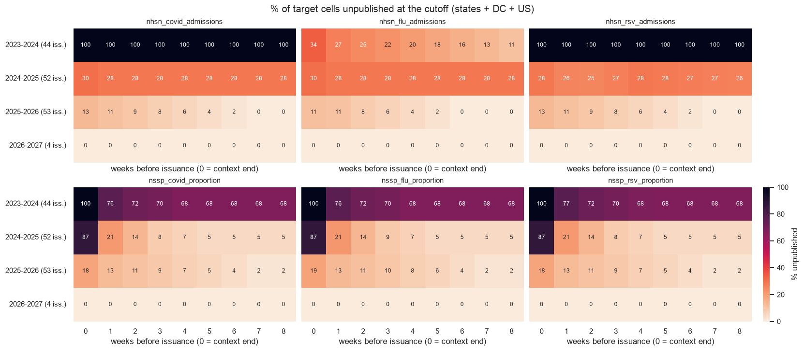
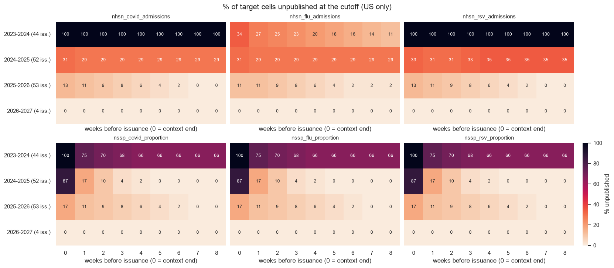
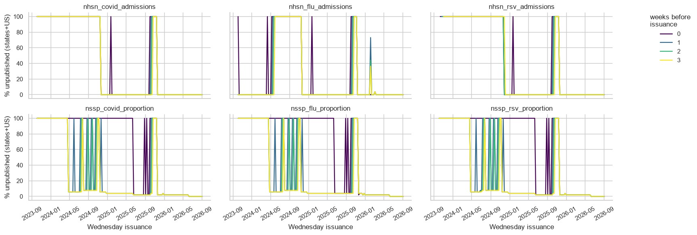
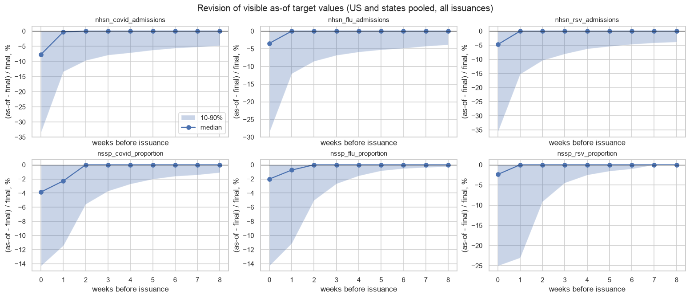
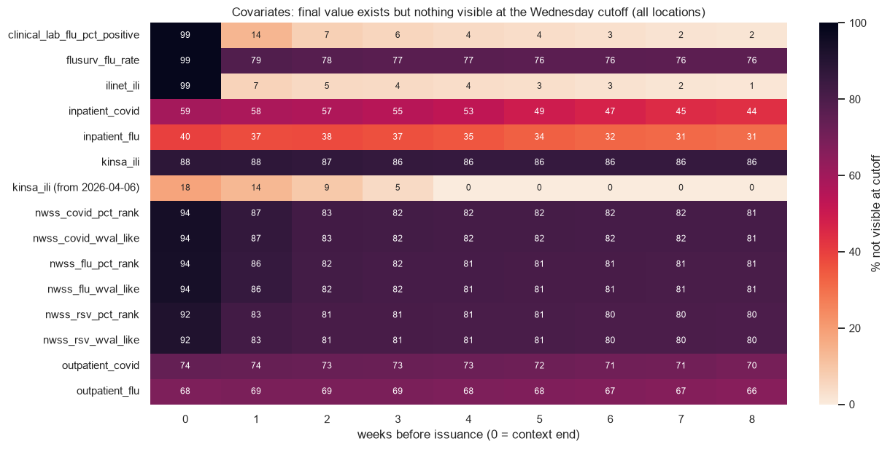
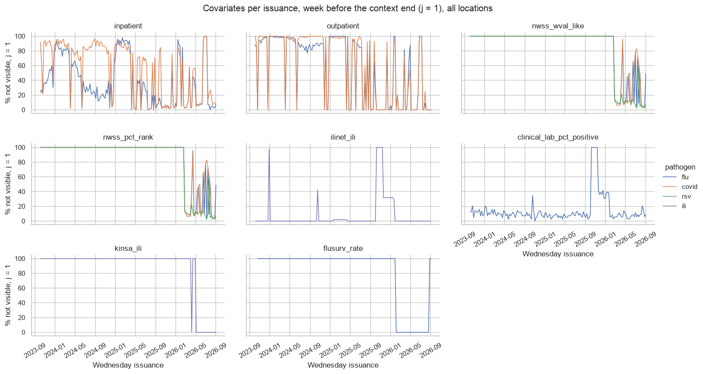
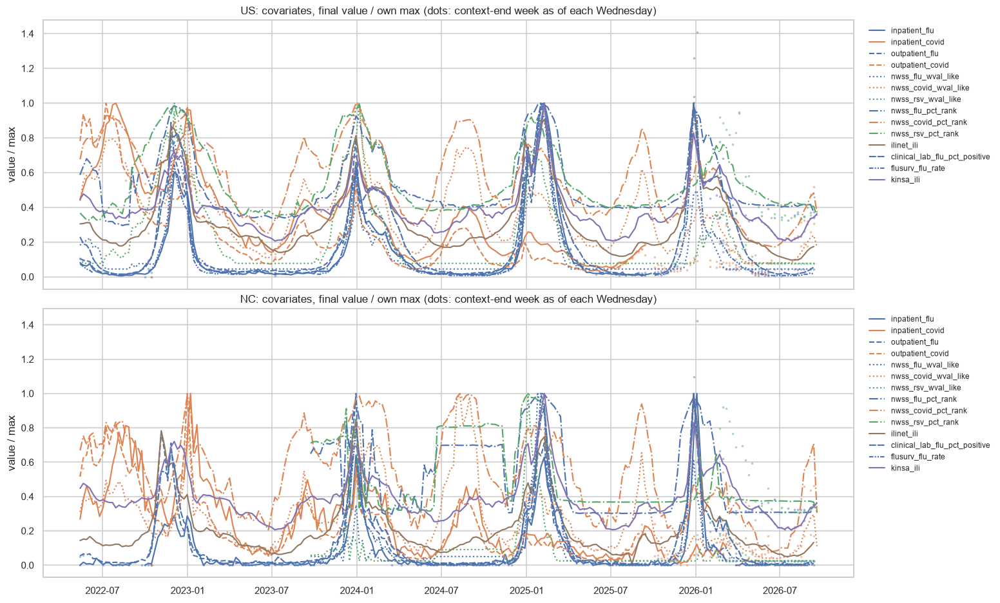
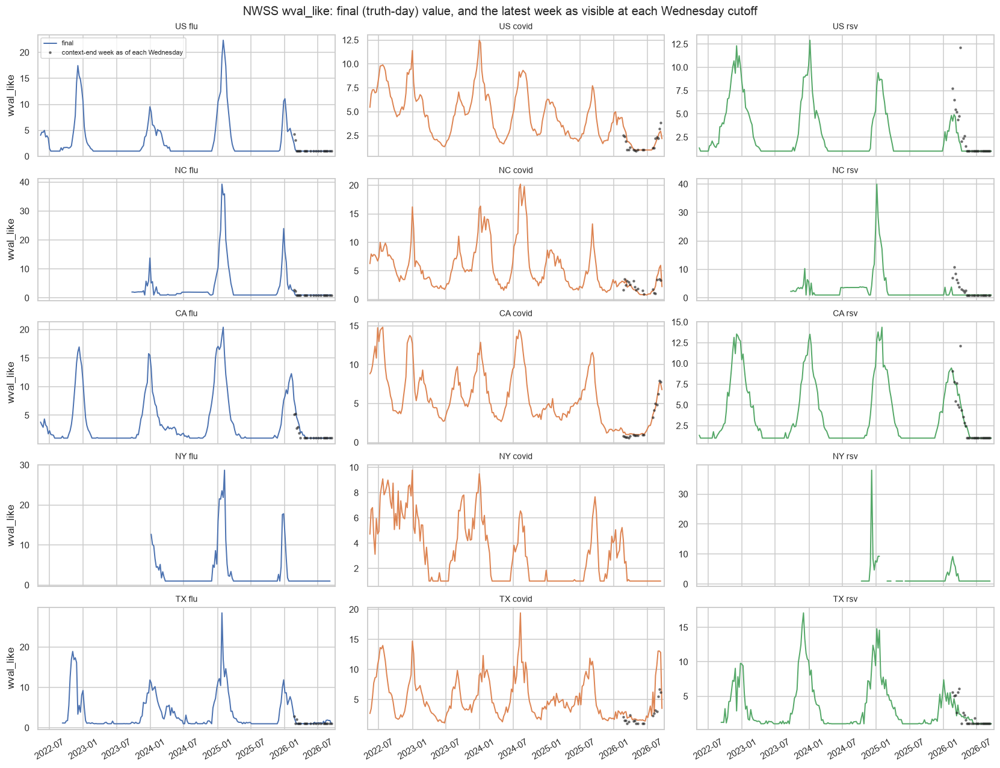
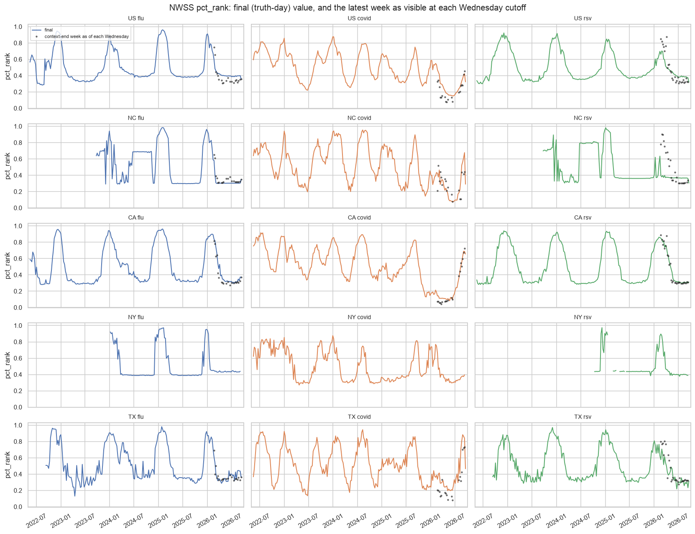
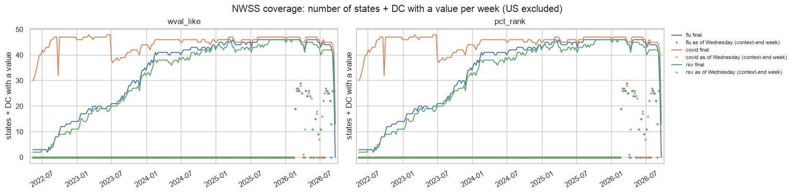

# Dataset panel: unpublished cells, revisions, covariates

Generated by `python -m chromantis.dataset.analyze_dataset --dataset data/processed/panel.npz` (rerun after every panel rebuild). All numbers and figures are computed from the panel; definitions are in the module docstring and below. Design: [data contract](index.md#current-dataset).

## Panel

- file: `data/processed/panel.npz`, sha256 `b3cb41a0a1a06541221128b9f9e6b21f1456f7836b89f9b5b364d25233de6287`, 20.9 MB
- build: version 4, truth day 2026-09-22, calendar 2022-05-14 to 2026-09-19
- dimensions: 228 Saturdays x 52 locations x 6 targets; 13 state covariates, 1 national covariate(s)
- issuances: 228 Wednesdays, 2022-05-11 to 2026-09-16; 153 vintaged episodes kept (lookback = asof_weeks = 9)
- raw snapshots: `delphi_claims_inpatient` 20260916T142718.964296Z, `delphi_claims_outpatient` 20260916T142831.880328Z, `delphi_flusurv` 20260922T204051.916853Z, `delphi_fluview_clinical` 20260922T204051.880663Z, `delphi_fluview_ilinet` 20260922T204051.781844Z, `delphi_nhsn` 20260916T142715.158100Z, `delphi_nssp` 20260916T142717.398812Z, `derived_nwss_state_indices` 20260922T170917.373373Z, `hub_covid_current` 20260917T132454.400755Z, `hub_flusight_current` 20260917T132413.278230Z, `hub_rsv_current` 20260917T132503.803731Z, `pophive_kinsa_ili` 20260921T161214.502587Z, `cdc_nhsn_final` 20260916T142609.954594Z

## 1. Unpublished cells in vintaged episodes

In vintaged mode, a target cell in the as-of window with nothing visible at the Wednesday cutoff is **unavailable** (`available=False`), not filled with final truth. This section measures how many cells that is. j = weeks before issuance: j = 0 is the context end (Saturday four days before the Wednesday). Share = unpublished cells / cells that exist at all (visible at the cutoff or present in the final truth). A missing archive and a not-yet-reported week both count. The default `asof_weeks=2` uses j = 0 and 1 only; larger `asof_weeks` use more columns.

### Headline: all seasons pooled, % unpublished

The last season listed is the one in progress at the truth day (few issuances).

| target | states+US j=0 | states+US j=1 | states+US j=2 | US j=0 | US j=1 | US j=2 |
|---|---|---|---|---|---|---|
| nhsn_covid_admissions | 43.5 | 42.2 | 41.6 | 43.8 | 42.5 | 41.8 |
| nhsn_flu_admissions | 23.9 | 21.1 | 19.6 | 24.2 | 21.6 | 20.3 |
| nhsn_rsv_admissions | 35.8 | 33.8 | 32.5 | 44.1 | 42.4 | 41.3 |
| nssp_covid_proportion | 64.6 | 33.5 | 29.2 | 64.1 | 31.4 | 26.8 |
| nssp_flu_proportion | 64.8 | 33.7 | 29.5 | 64.1 | 31.4 | 26.8 |
| nssp_rsv_proportion | 64.6 | 33.5 | 29.2 | 64.1 | 31.4 | 26.8 |

### Whole-issuance gaps

Issuances (per target, season of the context end) in which no j <= 1 cell had an as-of value, i.e. the whole default as-of window was unavailable, over all issuances with such a cell.

| target | season | all unpublished | issuances |
|---|---|---|---|
| nhsn_covid_admissions | 2023-2024 (44 iss.) | 44 | 44 |
| nhsn_covid_admissions | 2024-2025 (52 iss.) | 15 | 52 |
| nhsn_covid_admissions | 2025-2026 (53 iss.) | 6 | 53 |
| nhsn_covid_admissions | 2026-2027 (4 iss.) | 0 | 4 |
| nhsn_flu_admissions | 2023-2024 (44 iss.) | 12 | 44 |
| nhsn_flu_admissions | 2024-2025 (52 iss.) | 15 | 52 |
| nhsn_flu_admissions | 2025-2026 (53 iss.) | 5 | 53 |
| nhsn_flu_admissions | 2026-2027 (4 iss.) | 0 | 4 |
| nhsn_rsv_admissions | 2023-2024 (44 iss.) | 43 | 43 |
| nhsn_rsv_admissions | 2024-2025 (52 iss.) | 16 | 52 |
| nhsn_rsv_admissions | 2025-2026 (53 iss.) | 6 | 53 |
| nhsn_rsv_admissions | 2026-2027 (4 iss.) | 0 | 4 |
| nssp_covid_proportion | 2023-2024 (44 iss.) | 33 | 44 |
| nssp_covid_proportion | 2024-2025 (52 iss.) | 9 | 52 |
| nssp_covid_proportion | 2025-2026 (53 iss.) | 6 | 53 |
| nssp_covid_proportion | 2026-2027 (4 iss.) | 0 | 4 |
| nssp_flu_proportion | 2023-2024 (44 iss.) | 33 | 44 |
| nssp_flu_proportion | 2024-2025 (52 iss.) | 9 | 52 |
| nssp_flu_proportion | 2025-2026 (53 iss.) | 6 | 53 |
| nssp_flu_proportion | 2026-2027 (4 iss.) | 0 | 4 |
| nssp_rsv_proportion | 2023-2024 (44 iss.) | 33 | 44 |
| nssp_rsv_proportion | 2024-2025 (52 iss.) | 9 | 52 |
| nssp_rsv_proportion | 2025-2026 (53 iss.) | 6 | 53 |
| nssp_rsv_proportion | 2026-2027 (4 iss.) | 0 | 4 |

### Per issuance (states+US, j = 0..3)

### Table, states+US, % unpublished by j

| target | season | 0 | 1 | 2 | 3 | 4 | 5 | 6 | 7 | 8 |
|---|---|---|---|---|---|---|---|---|---|---|
| nhsn_covid_admissions | 2023-2024 (44 iss.) | 100.0 | 100.0 | 100.0 | 100.0 | 100.0 | 100.0 | 100.0 | 100.0 | 100.0 |
| nhsn_covid_admissions | 2024-2025 (52 iss.) | 30.2 | 28.2 | 28.2 | 28.2 | 28.2 | 28.2 | 28.3 | 28.3 | 28.3 |
| nhsn_covid_admissions | 2025-2026 (53 iss.) | 13.2 | 11.3 | 9.4 | 7.5 | 5.7 | 3.8 | 1.9 | 0.0 | 0.0 |
| nhsn_covid_admissions | 2026-2027 (4 iss.) | 0.0 | 0.0 | 0.0 | 0.0 | 0.0 | 0.0 | 0.0 | 0.0 | 0.0 |
| nhsn_flu_admissions | 2023-2024 (44 iss.) | 33.7 | 26.9 | 24.6 | 22.3 | 20.0 | 17.8 | 15.5 | 13.3 | 11.1 |
| nhsn_flu_admissions | 2024-2025 (52 iss.) | 30.2 | 28.2 | 28.2 | 28.2 | 28.2 | 28.2 | 28.3 | 28.3 | 28.3 |
| nhsn_flu_admissions | 2025-2026 (53 iss.) | 11.4 | 10.9 | 8.5 | 6.4 | 4.4 | 2.4 | 0.4 | 0.3 | 0.3 |
| nhsn_flu_admissions | 2026-2027 (4 iss.) | 0.0 | 0.0 | 0.0 | 0.0 | 0.0 | 0.0 | 0.0 | 0.0 | 0.0 |
| nhsn_rsv_admissions | 2023-2024 (44 iss.) | 100.0 | 100.0 | 100.0 | 100.0 | 100.0 | 100.0 | 100.0 | 100.0 | 100.0 |
| nhsn_rsv_admissions | 2024-2025 (52 iss.) | 28.3 | 25.7 | 25.2 | 26.7 | 28.3 | 27.8 | 27.3 | 26.9 | 26.4 |
| nhsn_rsv_admissions | 2025-2026 (53 iss.) | 13.2 | 11.3 | 9.4 | 7.5 | 5.7 | 3.8 | 1.9 | 0.0 | 0.0 |
| nhsn_rsv_admissions | 2026-2027 (4 iss.) | 0.0 | 0.0 | 0.0 | 0.0 | 0.0 | 0.0 | 0.0 | 0.0 | 0.0 |
| nssp_covid_proportion | 2023-2024 (44 iss.) | 100.0 | 76.5 | 72.2 | 70.1 | 67.9 | 67.9 | 67.9 | 67.9 | 67.9 |
| nssp_covid_proportion | 2024-2025 (52 iss.) | 86.8 | 20.9 | 13.7 | 8.4 | 6.6 | 4.8 | 4.8 | 4.7 | 4.7 |
| nssp_covid_proportion | 2025-2026 (53 iss.) | 18.3 | 12.7 | 10.9 | 9.1 | 7.3 | 5.5 | 3.7 | 1.9 | 1.9 |
| nssp_covid_proportion | 2026-2027 (4 iss.) | 0.0 | 0.0 | 0.0 | 0.0 | 0.0 | 0.0 | 0.0 | 0.0 | 0.0 |
| nssp_flu_proportion | 2023-2024 (44 iss.) | 100.0 | 76.5 | 72.2 | 70.1 | 67.9 | 67.9 | 67.9 | 67.9 | 67.9 |
| nssp_flu_proportion | 2024-2025 (52 iss.) | 87.1 | 21.1 | 14.0 | 8.7 | 6.9 | 5.1 | 5.0 | 5.0 | 5.0 |
| nssp_flu_proportion | 2025-2026 (53 iss.) | 18.6 | 13.2 | 11.4 | 9.6 | 7.8 | 6.0 | 4.1 | 2.3 | 2.3 |
| nssp_flu_proportion | 2026-2027 (4 iss.) | 0.0 | 0.0 | 0.0 | 0.0 | 0.0 | 0.0 | 0.0 | 0.0 | 0.0 |
| nssp_rsv_proportion | 2023-2024 (44 iss.) | 100.0 | 76.6 | 72.3 | 70.1 | 68.0 | 68.0 | 67.9 | 67.9 | 67.9 |
| nssp_rsv_proportion | 2024-2025 (52 iss.) | 86.8 | 20.9 | 13.7 | 8.4 | 6.6 | 4.8 | 4.8 | 4.8 | 4.8 |
| nssp_rsv_proportion | 2025-2026 (53 iss.) | 18.3 | 12.7 | 10.9 | 9.1 | 7.3 | 5.5 | 3.7 | 1.9 | 1.9 |
| nssp_rsv_proportion | 2026-2027 (4 iss.) | 0.0 | 0.0 | 0.0 | 0.0 | 0.0 | 0.0 | 0.0 | 0.0 | 0.0 |

### Table, US only, % unpublished by j

| target | season | 0 | 1 | 2 | 3 | 4 | 5 | 6 | 7 | 8 |
|---|---|---|---|---|---|---|---|---|---|---|
| nhsn_covid_admissions | 2023-2024 (44 iss.) | 100.0 | 100.0 | 100.0 | 100.0 | 100.0 | 100.0 | 100.0 | 100.0 | 100.0 |
| nhsn_covid_admissions | 2024-2025 (52 iss.) | 30.8 | 28.8 | 28.8 | 28.8 | 28.8 | 28.8 | 28.8 | 28.8 | 28.8 |
| nhsn_covid_admissions | 2025-2026 (53 iss.) | 13.2 | 11.3 | 9.4 | 7.5 | 5.7 | 3.8 | 1.9 | 0.0 | 0.0 |
| nhsn_covid_admissions | 2026-2027 (4 iss.) | 0.0 | 0.0 | 0.0 | 0.0 | 0.0 | 0.0 | 0.0 | 0.0 | 0.0 |
| nhsn_flu_admissions | 2023-2024 (44 iss.) | 34.1 | 27.3 | 25.0 | 22.7 | 20.5 | 18.2 | 15.9 | 13.6 | 11.4 |
| nhsn_flu_admissions | 2024-2025 (52 iss.) | 30.8 | 28.8 | 28.8 | 28.8 | 28.8 | 28.8 | 28.8 | 28.8 | 28.8 |
| nhsn_flu_admissions | 2025-2026 (53 iss.) | 11.3 | 11.3 | 9.4 | 7.5 | 5.7 | 3.8 | 1.9 | 1.9 | 1.9 |
| nhsn_flu_admissions | 2026-2027 (4 iss.) | 0.0 | 0.0 | 0.0 | 0.0 | 0.0 | 0.0 | 0.0 | 0.0 | 0.0 |
| nhsn_rsv_admissions | 2023-2024 (44 iss.) | 100.0 | 100.0 | 100.0 | 100.0 | 100.0 | 100.0 | 100.0 | 100.0 | 100.0 |
| nhsn_rsv_admissions | 2024-2025 (52 iss.) | 32.7 | 30.8 | 30.8 | 32.7 | 34.6 | 34.6 | 34.6 | 34.6 | 34.6 |
| nhsn_rsv_admissions | 2025-2026 (53 iss.) | 13.2 | 11.3 | 9.4 | 7.5 | 5.7 | 3.8 | 1.9 | 0.0 | 0.0 |
| nhsn_rsv_admissions | 2026-2027 (4 iss.) | 0.0 | 0.0 | 0.0 | 0.0 | 0.0 | 0.0 | 0.0 | 0.0 | 0.0 |
| nssp_covid_proportion | 2023-2024 (44 iss.) | 100.0 | 75.0 | 70.5 | 68.2 | 65.9 | 65.9 | 65.9 | 65.9 | 65.9 |
| nssp_covid_proportion | 2024-2025 (52 iss.) | 86.5 | 17.3 | 9.6 | 3.8 | 1.9 | 0.0 | 0.0 | 0.0 | 0.0 |
| nssp_covid_proportion | 2025-2026 (53 iss.) | 17.0 | 11.3 | 9.4 | 7.5 | 5.7 | 3.8 | 1.9 | 0.0 | 0.0 |
| nssp_covid_proportion | 2026-2027 (4 iss.) | 0.0 | 0.0 | 0.0 | 0.0 | 0.0 | 0.0 | 0.0 | 0.0 | 0.0 |
| nssp_flu_proportion | 2023-2024 (44 iss.) | 100.0 | 75.0 | 70.5 | 68.2 | 65.9 | 65.9 | 65.9 | 65.9 | 65.9 |
| nssp_flu_proportion | 2024-2025 (52 iss.) | 86.5 | 17.3 | 9.6 | 3.8 | 1.9 | 0.0 | 0.0 | 0.0 | 0.0 |
| nssp_flu_proportion | 2025-2026 (53 iss.) | 17.0 | 11.3 | 9.4 | 7.5 | 5.7 | 3.8 | 1.9 | 0.0 | 0.0 |
| nssp_flu_proportion | 2026-2027 (4 iss.) | 0.0 | 0.0 | 0.0 | 0.0 | 0.0 | 0.0 | 0.0 | 0.0 | 0.0 |
| nssp_rsv_proportion | 2023-2024 (44 iss.) | 100.0 | 75.0 | 70.5 | 68.2 | 65.9 | 65.9 | 65.9 | 65.9 | 65.9 |
| nssp_rsv_proportion | 2024-2025 (52 iss.) | 86.5 | 17.3 | 9.6 | 3.8 | 1.9 | 0.0 | 0.0 | 0.0 | 0.0 |
| nssp_rsv_proportion | 2025-2026 (53 iss.) | 17.0 | 11.3 | 9.4 | 7.5 | 5.7 | 3.8 | 1.9 | 0.0 | 0.0 |
| nssp_rsv_proportion | 2026-2027 (4 iss.) | 0.0 | 0.0 | 0.0 | 0.0 | 0.0 | 0.0 | 0.0 | 0.0 | 0.0 |

## 2. Revision where an as-of value was visible

(as-of - final) / final in %, on cells with a visible as-of value and final > 0, US and states pooled, all issuances.

| target | j | count | p10 | median | p90 |
|---|---|---|---|---|---|
| nhsn_covid_admissions | 0 | 4416.0 | -33.3 | -7.7 | 0.0 |
| nhsn_covid_admissions | 1 | 4522.0 | -13.3 | -0.3 | 0.0 |
| nhsn_covid_admissions | 2 | 4576.0 | -9.7 | 0.0 | 0.0 |
| nhsn_covid_admissions | 3 | 4628.0 | -7.9 | 0.0 | 0.0 |
| nhsn_covid_admissions | 4 | 4680.0 | -7.1 | 0.0 | 0.0 |
| nhsn_covid_admissions | 5 | 4728.0 | -6.2 | 0.0 | 0.0 |
| nhsn_covid_admissions | 6 | 4782.0 | -5.6 | 0.0 | 0.0 |
| nhsn_covid_admissions | 7 | 4836.0 | -5.2 | 0.0 | 0.0 |
| nhsn_covid_admissions | 8 | 4835.0 | -4.8 | 0.0 | 0.0 |
| nhsn_flu_admissions | 0 | 5816.0 | -28.6 | -3.4 | 0.0 |
| nhsn_flu_admissions | 1 | 6024.0 | -12.0 | 0.0 | 0.0 |
| nhsn_flu_admissions | 2 | 6127.0 | -8.5 | 0.0 | 0.0 |
| nhsn_flu_admissions | 3 | 6216.0 | -6.8 | 0.0 | 0.0 |
| nhsn_flu_admissions | 4 | 6305.0 | -5.9 | 0.0 | 0.0 |
| nhsn_flu_admissions | 5 | 6379.0 | -5.3 | 0.0 | 0.0 |
| nhsn_flu_admissions | 6 | 6455.0 | -4.9 | 0.0 | 0.0 |
| nhsn_flu_admissions | 7 | 6492.0 | -4.3 | 0.0 | 0.0 |
| nhsn_flu_admissions | 8 | 6525.0 | -3.8 | 0.0 | 0.0 |
| nhsn_rsv_admissions | 0 | 3977.0 | -35.7 | -4.7 | 0.0 |
| nhsn_rsv_admissions | 1 | 4092.0 | -15.2 | 0.0 | 0.0 |
| nhsn_rsv_admissions | 2 | 4140.0 | -10.3 | 0.0 | 0.0 |
| nhsn_rsv_admissions | 3 | 4141.0 | -8.0 | 0.0 | 0.0 |
| nhsn_rsv_admissions | 4 | 4151.0 | -6.2 | 0.0 | 0.0 |
| nhsn_rsv_admissions | 5 | 4193.0 | -5.4 | 0.0 | 0.0 |
| nhsn_rsv_admissions | 6 | 4235.0 | -4.7 | 0.0 | 0.0 |
| nhsn_rsv_admissions | 7 | 4257.0 | -4.1 | 0.0 | 0.0 |
| nhsn_rsv_admissions | 8 | 4229.0 | -3.8 | 0.0 | 0.0 |
| nssp_covid_proportion | 0 | 2798.0 | -14.3 | -3.8 | 0.0 |
| nssp_covid_proportion | 1 | 5272.0 | -11.4 | -2.3 | 0.0 |
| nssp_covid_proportion | 2 | 5613.0 | -5.6 | 0.0 | 0.0 |
| nssp_covid_proportion | 3 | 5856.0 | -3.7 | 0.0 | 0.0 |
| nssp_covid_proportion | 4 | 6005.0 | -2.7 | 0.0 | 0.0 |
| nssp_covid_proportion | 5 | 6105.0 | -2.0 | 0.0 | 0.0 |
| nssp_covid_proportion | 6 | 6158.0 | -1.6 | 0.0 | 0.0 |
| nssp_covid_proportion | 7 | 6210.0 | -1.4 | 0.0 | 0.0 |
| nssp_covid_proportion | 8 | 6213.0 | -1.1 | 0.0 | 0.0 |
| nssp_flu_proportion | 0 | 2775.0 | -14.3 | -2.0 | 0.0 |
| nssp_flu_proportion | 1 | 5240.0 | -11.1 | -0.7 | 0.0 |
| nssp_flu_proportion | 2 | 5578.0 | -5.0 | 0.0 | 0.0 |
| nssp_flu_proportion | 3 | 5820.0 | -2.7 | 0.0 | 0.0 |
| nssp_flu_proportion | 4 | 5969.0 | -1.5 | 0.0 | 0.0 |
| nssp_flu_proportion | 5 | 6068.0 | -0.8 | 0.0 | 0.0 |
| nssp_flu_proportion | 6 | 6122.0 | -0.5 | 0.0 | 0.0 |
| nssp_flu_proportion | 7 | 6173.0 | -0.4 | 0.0 | 0.0 |
| nssp_flu_proportion | 8 | 6175.0 | -0.2 | 0.0 | 0.0 |
| nssp_rsv_proportion | 0 | 2550.0 | -25.0 | -2.4 | 0.0 |
| nssp_rsv_proportion | 1 | 4903.0 | -23.0 | 0.0 | 0.0 |
| nssp_rsv_proportion | 2 | 5207.0 | -9.1 | 0.0 | 0.0 |
| nssp_rsv_proportion | 3 | 5418.0 | -4.4 | 0.0 | 0.0 |
| nssp_rsv_proportion | 4 | 5561.0 | -2.5 | 0.0 | 0.0 |
| nssp_rsv_proportion | 5 | 5659.0 | -1.5 | 0.0 | 0.0 |
| nssp_rsv_proportion | 6 | 5712.0 | -1.0 | 0.0 | 0.0 |
| nssp_rsv_proportion | 7 | 5764.0 | -0.0 | 0.0 | 0.0 |
| nssp_rsv_proportion | 8 | 5772.0 | -0.0 | 0.0 | 0.0 |

## 3. Covariates: final value present but not visible at the cutoff

Covariate cells not visible at the cutoff are unavailable (as target cells now are). % of cells with a final value, all locations and issuances. Kinsa (US only) has as-of data only from 2026-04-06; its row restricted to issuances from then on is shown separately.

| covariate | 0 | 1 | 2 | 3 | 4 | 5 | 6 | 7 | 8 |
|---|---|---|---|---|---|---|---|---|---|
| clinical_lab_flu_pct_positive | 98.6 | 13.9 | 7.3 | 5.5 | 4.4 | 3.6 | 2.9 | 2.0 | 1.6 |
| flusurv_flu_rate | 98.5 | 78.6 | 77.7 | 76.7 | 76.6 | 76.4 | 76.2 | 76.0 | 75.8 |
| ilinet_ili | 98.5 | 6.5 | 5.0 | 4.4 | 3.7 | 3.1 | 2.5 | 1.6 | 1.4 |
| inpatient_covid | 59.3 | 57.8 | 56.7 | 54.7 | 53.0 | 49.5 | 47.1 | 44.7 | 43.5 |
| inpatient_flu | 39.8 | 37.4 | 37.5 | 36.7 | 35.4 | 33.6 | 32.4 | 31.3 | 30.5 |
| kinsa_ili | 88.2 | 87.6 | 86.9 | 86.3 | 85.6 | 85.6 | 85.6 | 85.6 | 85.6 |
| kinsa_ili (from 2026-04-06) | 18.2 | 13.6 | 9.1 | 4.5 | 0.0 | 0.0 | 0.0 | 0.0 | 0.0 |
| nwss_covid_pct_rank | 94.2 | 86.7 | 82.6 | 82.1 | 81.9 | 81.7 | 81.6 | 81.5 | 81.4 |
| nwss_covid_wval_like | 94.2 | 86.7 | 82.6 | 82.1 | 81.9 | 81.7 | 81.6 | 81.5 | 81.4 |
| nwss_flu_pct_rank | 93.8 | 85.6 | 82.1 | 81.6 | 81.3 | 81.0 | 80.9 | 80.7 | 80.6 |
| nwss_flu_wval_like | 93.8 | 85.6 | 82.1 | 81.6 | 81.3 | 81.0 | 80.9 | 80.7 | 80.6 |
| nwss_rsv_pct_rank | 91.7 | 82.5 | 81.2 | 80.9 | 80.7 | 80.6 | 80.4 | 80.3 | 80.1 |
| nwss_rsv_wval_like | 91.7 | 82.5 | 81.2 | 80.9 | 80.7 | 80.6 | 80.4 | 80.3 | 80.1 |
| outpatient_covid | 74.0 | 73.6 | 73.2 | 73.0 | 72.5 | 71.9 | 71.4 | 70.8 | 69.7 |
| outpatient_flu | 68.3 | 69.1 | 68.8 | 68.8 | 68.4 | 67.7 | 67.5 | 66.8 | 66.0 |

## 4. Covariates in US and NC

Final (truth-day) values, each divided by its own maximum at that location over the calendar. Colour = pathogen, line style = source (solid inpatient claims, dashed outpatient claims, dotted NWSS wval_like, dash-dot NWSS pct_rank; Kinsa purple; ILINet ILI brown; long dashes clinical-lab influenza percent positive; dash-dot-dot FluSurv-NET rate). Faint dots: the context-end week of each Wednesday issuance as visible at its cutoff, same scale (the latest as-of value an episode sees). A covariate with no value at a location is listed in the legend as not available.

## 5. Wastewater indices (NWSS)

The two indices per pathogen, `wval_like` and `pct_rank`, from the `derived_nwss_state_indices` snapshot (rebuilt by `python -m chromantis.dataset.build nwss-indices`; definitions in [wastewater](sources.md#wastewater)). Lines: final (truth-day) value per week; dots: the context-end week as visible at each Wednesday cutoff (NaN before the first Delphi archive vintage, 2026-02-25). Weeks with any value: 2022-05-14 to 2026-09-19; plotted range restricted to it. States need at least 3 eligible sites.

### Coverage

Number of states + DC with a value per week (US excluded): final truth (line) and the context-end week as of each Wednesday (dots). `issuances_with_asof` = Wednesdays whose context-end week had a value for at least one state.

| index | pathogen | weeks_with_any_state | states_median | states_max | issuances_with_asof |
|---|---|---|---|---|---|
| wval_like | flu | 227 | 41.0 | 46 | 20 |
| wval_like | covid | 228 | 46.0 | 48 | 19 |
| wval_like | rsv | 228 | 38.0 | 46 | 28 |
| pct_rank | flu | 227 | 41.0 | 46 | 20 |
| pct_rank | covid | 228 | 46.0 | 48 | 19 |
| pct_rank | rsv | 228 | 38.0 | 46 | 28 |
