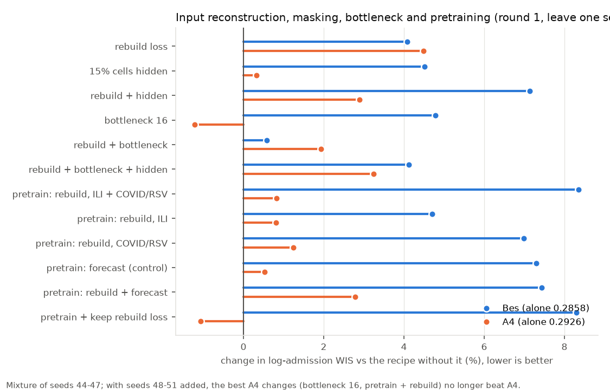
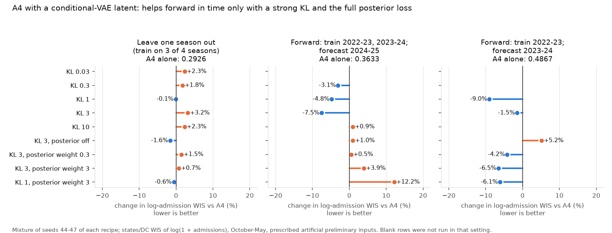
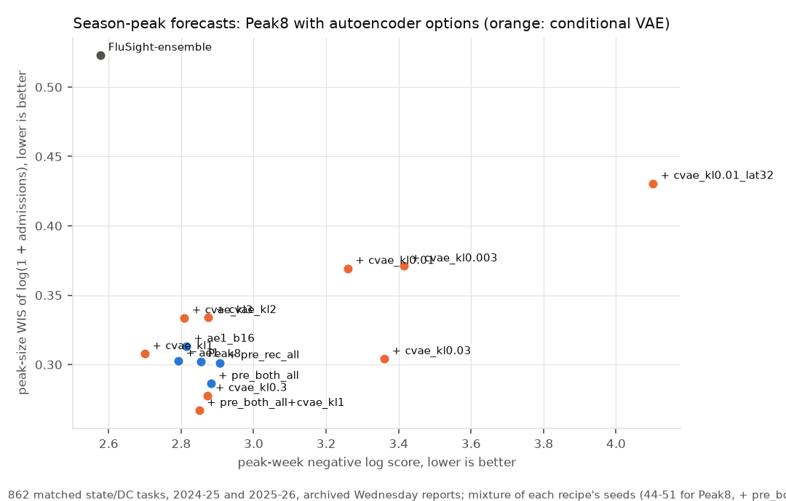

# Autoencoders and conditional VAEs (24–26 October 2026)

**Question.** Production Chromantis models are small MLPs that never use an autoencoder,
self-supervised pretraining or a learned latent. Over 24–26 October we tested three such
ideas on the flu weekly recipes, the season-peak model and the RSV sampled recipes:

1. **Same data, extra loss:** a head that rebuilds all 12 weeks of every input history from
   the location's representation (mean squared error in the network's normalized space),
   random hiding of 15% of input cells (masked autoencoding), and a 16- or 32-number linear
   bottleneck before the decoder.
2. **Extra data:** 2,000 pretraining updates before normal training, on pre-August-2022
   state ILI and the panel's COVID and RSV series (fitting weeks only, rescaled per location to
   the flu admission and ED levels), by masked reconstruction, forecasting, or both.
3. **Conditional VAE latent** (sampled recipes only). Sampled models draw 16 random numbers
   per issuance that shape the forecast trajectories. Here those numbers come from a
   distribution the network learns from the history (the *prior*). In training, a second
   network that also sees the true future (the *posterior*) proposes numbers that must
   reproduce that future; a KL penalty with weight *KL* keeps posterior and prior close.
   Forecasts draw from the prior. The usual sample loss is kept.

**Answer.** Arms 1 and 2 do not help the weekly models. The conditional VAE helps only with a
strong KL weight (1 or 3) and the full posterior loss, and only when forecasting forward in
time from few seasons: it improves A4 by 3–8% there and lets A4 improve a Bes mixture, but
it is neutral to slightly harmful in leave-one-season-out folds, where training includes
seasons after the forecast one. Weak KL weights (0.003–0.03) make sampled models overconfident
and much worse forward in time. Bes, the submitted direct-quantile recipe, cannot use the
latent and none of the other options improve it. No change is recommended for the submitted
weekly recipes. For the season-peak model the strong-KL latent is the most useful result:
peak-week log score 2.854 → 2.700 (8 seeds, both seasons better), against 2.578 for the
FluSight ensemble, at about the same peak size; pretraining on extra series improves peak size
by 5%.

## Setup

| Item | Value |
|---|---|
| Weekly problem | Flu admissions and flu ED share, 1–4 weeks ahead (`us-flu-short-term-prescribed`, the 10 October tree-search testbed) |
| Leave-one-season-out | Each of 2023–24, 2024–25, 2025–26 held out; trained on the other three of 2022–23..2025–26 |
| Forward checks | Trained on 2022–23 and 2023–24, forecast 2024–25; trained on 2022–23 only, forecast 2023–24 (new problem `us-flu-forward-2023-24-prescribed`). In leave-one-season-out, the 2025–26 fold is also forward in time |
| Training labels | Latest finalized future flu admissions and ED share |
| Evaluation inputs | Three artificial preliminary histories from the prescribed 2025–26 reporting process, the same for every recipe and seed |
| Score | States/DC mean WIS of log(1 + admissions), October–May, horizons 0–3, seasons equal; lower is better |
| Seeds | Mixture of each recipe's seed predictive distributions; 44–47, plus 48–51 where marked "8 seeds" |
| References, rerun on today's code | **Bes** (width-256 direct-quantile MLP, artificial errors at 1.5x, submitted 17 October), **A4** (width-192 sampled MLP, corrected histories, Kinsa), **A_blocks3** and **B5** (the sampled members of the submitted B7 mixture) |

Bes on today's code scores 0.2858 (4 seeds), exactly its 10 October score, so the code
changes do not alter existing recipes. Experiments are `autoenc-20261024-*` on Longleaf
(`/hickory/proj/jlessler/projects/tapestry-all/autoenc-20261024`); the protocol with every
decision is `experiments/autoenc-20261024/protocol.json`.

## Arms 1 and 2: reconstruction, masking, bottleneck, pretraining

Every change made Bes worse (by 0.6% to 8%); pretraining hurt Bes most. On A4 two changes
looked slightly better with seeds 44–47 (bottleneck 16: 0.2891 against 0.2926; pretraining plus
rebuild: 0.2895), but with seeds 48–51 added both were worse than A4 (8 seeds: 0.2944 and
0.2932 against 0.2897). Forecasting pretraining on the same corpus (the old ILI idea) did no
better than reconstruction pretraining.

## Arm 3: the conditional VAE

8-seed mixtures, A4 and its strong-KL versions:

| Model | Leave one season out | 2025–26 fold (forward) | Forward: train 2 seasons | Forward: train 1 season |
|---|---|---|---|---|
| A4 | **0.2897** | 0.2813 | 0.3703 | 0.4600 |
| A4, VAE KL 1 | 0.2927 | 0.2786 | 0.3418 | **0.4442** |
| A4, VAE KL 3 | 0.2940 | **0.2765** | **0.3416** | 0.4663 |
| Bes | 0.2885 | 0.2871 | 0.3345 | **0.4079** |
| Bes + A4 | **0.2817** | 0.2752 | 0.3409 | 0.4233 |
| Bes + A4 VAE KL 1 | 0.2835 | 0.2749 | 0.3295 | 0.4160 |
| Bes + A4 VAE KL 3 | 0.2839 | **0.2738** | **0.3287** | 0.4239 |

- **Strong KL and the full posterior are both needed.** With KL 3, turning the posterior loss
  off or down to weight 0.3 removes the forward gain (2 seasons: 0.3668 and 0.3651 against
  0.3633 for A4 and 0.3360 with the full posterior, seeds 44–47); weight 3 is worse (0.3775).
  So the code learned from the future is doing the work, not just a history-dependent spread.
- **Weak KL fails forward.** A_blocks3 with KL 0.03 looked 3% better in leave-one-season-out
  (8 seeds: 0.3020 against 0.3117), mostly from a history-dependent prior alone; forward from two
  seasons it was much worse (0.4553 against 0.3926), its 90% intervals covering 62% instead of
  72%. B5 with KL 0.03 or 1 was worse forward (0.5508 and 0.4375 against 0.3814).
- **In mixtures** the strong-KL A4 makes Bes + A4 better than Bes alone when forecasting
  forward from two seasons (0.3287 against 0.3345), where plain A4 made it worse (0.3409), but
  with one training season Bes alone stays best, and in leave-one-season-out Bes + plain A4 is best.
- Width 384, KL 10 and a 32-number latent did not help.

**RSV** (`us-rsv-short-term-prescribed`, leave one season out, RSV admissions scored in 2024–25
and 2025–26, seeds 44–47): A4c0 0.3368 → 0.3269 (KL 0.03) and 0.3276 (KL 1); A4i 0.3247 → 0.3265
and 0.3265. In the forward 2025–26 fold the latent helps A4i (0.2486 → 0.2290 and 0.2400).

## Season peak

Peak8 (season-long sampled MLP, 36 weekly labels, weekly + path + peak losses), each held-out
season trained on the other three, scored on 862 matched state/DC tasks of 2024–25 and 2025–26
from archived Wednesday reports. Lower is better for both scores. 8-seed mixtures (seeds 44–51):

| Model | Peak-week log score | 2024–25 | 2025–26 | Peak-size log WIS |
|---|---|---|---|---|
| FluSight-ensemble | **2.578** | 2.712 | 2.401 | 0.523 |
| Peak8 + VAE latent, KL 1 | 2.700 | 2.888 | 2.451 | 0.308 |
| Peak8 (today's code) | 2.854 | 3.010 | 2.647 | 0.302 |
| Peak8 + pretraining (rebuild + forecast) | 2.882 | 3.020 | 2.698 | 0.286 |
| Peak8 + pretraining + VAE latent, KL 1 | 2.850 | 2.934 | 2.739 | **0.267** |

- The strong-KL latent improves peak timing by 5% in both seasons (4% and 7%) at about the same
  peak size, closing more than half of Peak8's timing gap to FluSight-ensemble. It held on both
  seed sets (44–47: 2.785 → 2.724; 48–51: 2.873 → 2.753), while its size effect did not (0.300 →
  0.337, then 0.304 → 0.293).
- Pretraining on extra series improves peak size by 5% on both seed sets (0.300 → 0.286 and
  0.304 → 0.290) with timing about unchanged. It is the only pretraining result that held.
- Pretraining and the latent together give the best peak size of any model (0.267, 12% better
  than Peak8) but lose the latent's timing gain (2.850). The two changes trade timing against
  size rather than adding up.
- Weak-KL latents ruin timing (seeds 44–47: 3.26–4.10); reconstruction alone is neutral (2.792, 0.303).
- The timing gain sits at a narrow KL optimum. On seeds 44–47 (Peak8: 2.785, 0.300), KL 0.3
  scored 2.873 and 0.278, KL 1 2.724 and 0.337, KL 2 2.875 and 0.334, KL 3 2.809 and 0.334. Only
  KL 1 beats Peak8 on timing, so a production choice should be confirmed on more seeds or a
  forward-only peak check before relying on it.

## What this means

- The weekly MLPs are limited by having seen four epidemics, not by representation: rebuilding
  inputs, bottlenecks and pretraining on extra series do not help.
- A strongly regularized conditional VAE is a real, small improvement for sampled models
  forecasting forward from little data. It is the only option here worth keeping as a
  research setting (`latent_model=cvae,kl_weight=1.0`).
- It does not change the weekly submission choice: Bes and Bes + A4 remain at least as good on
  the completed seasons.
- It is a candidate change for the season-peak submission (Peak8 + `latent_model=cvae,kl_weight=1.0`),
  pending a production retrain and a look at its forecasts.

## Code

`model/network.py`: `bottleneck`, `reconstruct_inputs`, `latent_model='cvae'` (prior, posterior
and future encoder); `experiment/training.py`: reconstruction loss, input masking, the posterior
sample loss and KL, pretraining corpus (`pretraining_corpus`, `other_pathogen_panel`) and
`autoencoder_pretrain`; scenario fields `autoencoder_weight`, `autoencoder_mask`, `bottleneck`,
`autoencoder_pretrain_steps`, `autoencoder_corpus`, `autoencoder_pretrain_task`, `latent_model`,
`cvae_weight`, `kl_weight`. Defaults reproduce every earlier recipe. Long-horizon minibatches and
validation passes are now split into smaller chunks (same gradient; 4-week problems unchanged).
Scoring: `scripts/autoenc_score.py`; figures: `scripts/plot_autoenc.py`.
