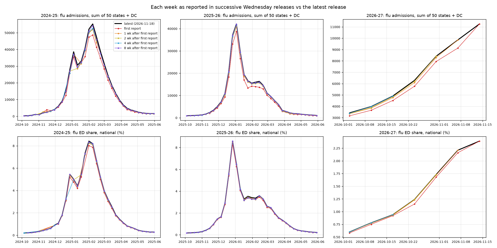
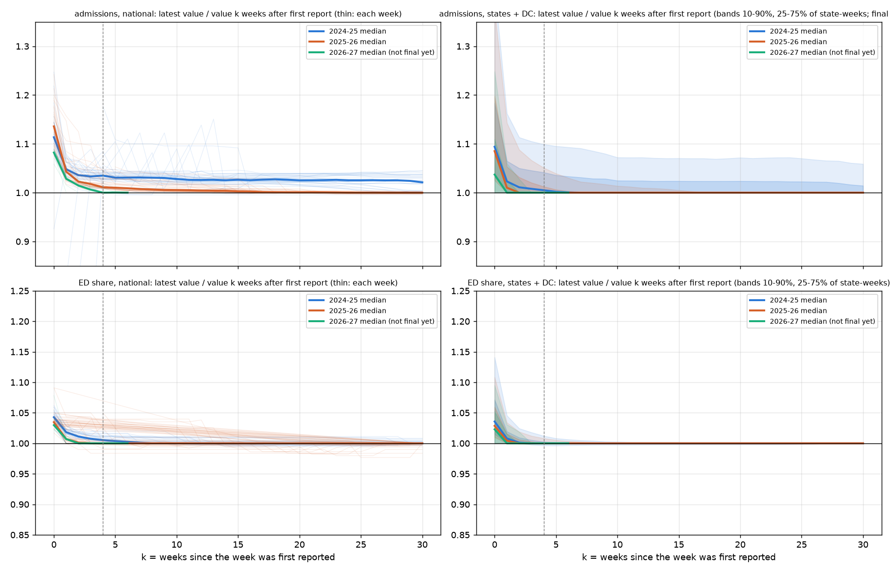
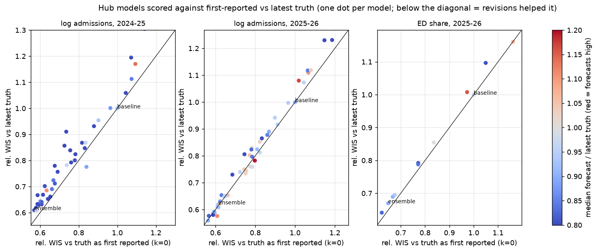
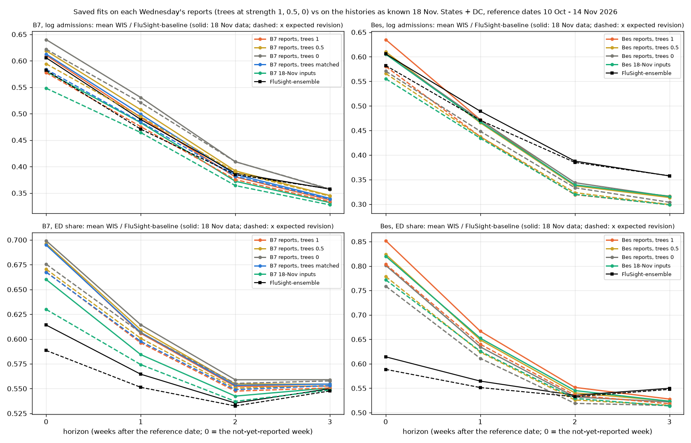
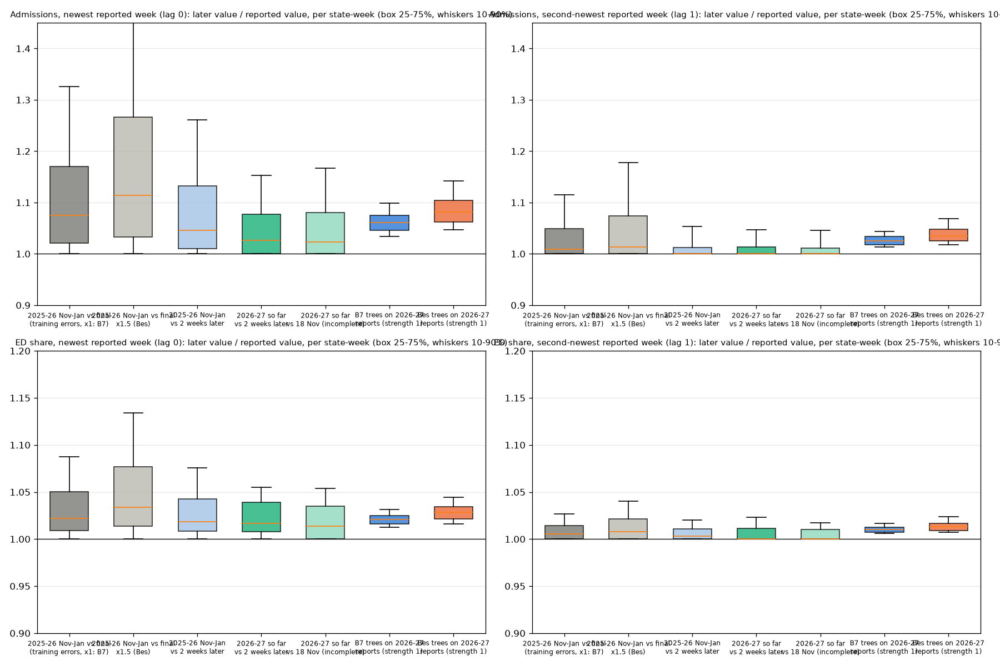

# FluSight: why the last two weeks scored badly, how much data revisions matter, and what nowcasting costs

20 November 2026. Data: the FluSight Hub clone and Delphi archives as of the 18 November 2026 release. No model was
retrained for this page. Saved flu fits were run on different inputs, and Hub forecasts were rescored.

## Summary

- **The CDC's evaluation of 18 November** ranks ACCIDDA-Chromantis 12th over the season so far, tied with the
  FluSight-ensemble. Over the last two target weeks (ending 7 and 14 November) it ranks 47th. Almost all of that
  loss comes from the forecast submitted for 7 November, made by Bes with its correction trees at half strength.
- **Bes is a high, steep forecaster.** For 17 October, flu kept growing fast and Bes was our best week (rank 2). For
  7 November, growth slowed and Bes over-forecast. B7, run on the same Wednesday reports, would have matched the
  ensemble that week.
- **Revisions after 4 weeks are small but not zero.** Nationally, admissions rose another 3.5% after 4 weeks in
  2024-25 and 1.1% in 2025-26. The median state is final after 2 weeks. ED share is final after about 2 weeks.
- **Revisions barely change Hub rankings.** In 2024-25 and 2025-26, ranking every Hub model against first-reported
  truth or against the latest truth gave rank correlations of 0.96 and 0.98, and above 0.99 from one week after the
  first report.
- **Expected revisions will improve our 2026-27 scores, but not enough to close the gap.** For the 7 and 14 November
  forecasts we stay about 13% behind the ensemble.
- **Nowcasting costs B7 about 5% of WIS at every horizon. It costs Bes nothing.** B7 run on the histories as known on
  18 November instead of each Wednesday's reports improves log-admission WIS by 6% at horizon 0 and 4–5% at
  horizons 1–3, against the half-strength trees we submit now. With those inputs B7 beats the ensemble at every
  horizon. Bes does not improve, because its network already corrects incomplete reports by itself.
- **This season's state revisions are smaller than the ones the models were trained on.** Two weeks after a first
  report, the median state's newest week has risen ×1.027 this season, against ×1.046 at the same point in
  2025-26. B7 was trained on the 2025-26 errors (median ×1.075 at final); Bes was trained on them at 1.5 times their
  strength (median ×1.114). The trees get the average about right for B7 but cannot tell which states will be
  revised.

## 1. The CDC evaluation of 18 November

The Hub's report (`reports/Flu_Hospitalizations_Forecasts_WIS_18 November 2026.html` in the Hub repository) scores
flu admissions against the 18 November data, including the national total. Log relative WIS: lower is better,
FluSight-baseline = 1.

| Window in the CDC report | ACCIDDA-Chromantis | FluSight-ensemble | Our rank |
|---|---|---|---|
| Season so far (target weeks ending 10 Oct to 14 Nov) | 0.48 | 0.48 | 12 |
| Last 4 forecasts (target weeks ending 24 Oct to 14 Nov) | 0.52 | 0.49 | 20 |
| Last 2 forecasts (target weeks ending 7 and 14 Nov) | 0.78 | 0.66 | 47 of about 80 |

In the "last 2" window, our 50% intervals covered 46% of observations; the ensemble's covered 68%.

## 2. What we submitted, and why Bes worked once and not twice

Every file was submitted as ACCIDDA-Chromantis. B7 is the three-recipe mixture (30 fits); Bes is its single
`B_width256` recipe trained with 1.5 times stronger artificial reporting errors (10 fits). All fits were trained on
the four seasons 2022-23 to 2025-26, with the latest finalized admissions and ED share as prediction labels, and none
was retrained during the season. Each week the saved fits read that Wednesday's reports. The trees correct the two
newest reported weeks, at the strength shown.

Scores below are pairwise relative WIS on log admissions for the 50 states and DC, over all horizons observed so
far, against the 18 November data (lower is better; FluSight-baseline = 1).

| Forecast for (reference date) | Model and tree strength | Score (rank) | FluSight-ensemble |
|---|---|---|---|
| 10 Oct | B7, original checkpoints, trees 1 | 0.43 (8 of 54) | 0.43 |
| 17 Oct | Bes, trees 1 | 0.34 (2 of 63) | 0.42 |
| 24 Oct | B7 retrained 9 Oct, trees 1 | 0.42 (16 of 63) | 0.42 |
| 31 Oct | B7 retrained 9 Oct, trees 1 | 0.40 (7 of 66) | 0.41 |
| 7 Nov | Bes, trees 0.5 | 0.74 (47 of 76) | 0.61 |
| 14 Nov | B7 retrained 9 Oct, trees 1 | 0.82 (41 of 76) | 0.75 |
| 21 Nov | B7 retrained 9 Oct, trees 0.5 | not scored yet | |

Bias is the mean of log(median forecast / observed) over states and DC; +0.10 means about 10% too high.

- **17 October forecast (Bes, trees 1).** Admissions grew 1.27 to 1.34 times a week through the week ending 31
  October. Bes's bias was +0.02, −0.06 and +0.09 at horizons 1, 2 and 3. The ensemble's was −0.15, −0.30 and
  −0.26. On 21 October we judged this file on horizon 0 only, against the first report: it then ranked 37th of 56,
  and we switched back to B7. With every horizon observed and the data revised, it ranks 2nd.
- **7 November forecast (Bes, trees 0.5).** Growth fell to 1.17 times in the week ending 7 November (8,417 to 9,848
  admissions, summed over states, 18 November data). Hospital reporting coverage was normal (87% for the newest
  week), so the slowdown is not a reporting artefact. Bes's bias was +0.19 at horizon 0 and +0.27 at horizon 1,
  against +0.07 and +0.22 for the ensemble. Its 50% intervals covered 55% and 39% of observations, against 79% and
  65% for the ensemble. B7 with half-strength trees, run on the same reports but not submitted, scored 0.66 on the
  7–14 November forecasts, the same as the ensemble (`production/output/2026-11-18/flu-scores-b7cs050.txt`).
- **14 November forecast (B7, trees 1).** The gap with the ensemble was small: bias +0.14 against +0.11 at horizon 0.
- The excess WIS over the ensemble on 7 and 14 November is spread across states: the ten worst states (Arizona and
  DC first) account for half of it.

## 3. How much the data are revised, up to 30 weeks after a first report

Each week's value is followed through every weekly release (Delphi's NHSN and NSSP archives, one release per week,
from 13 November 2024). The table shows the latest value divided by the value k weeks after the week was first
reported, as a median over in-season weeks [10th–90th percentile].

| National admissions (sum of 50 states + DC) | k = 0 | k = 1 | k = 2 | k = 4 | k = 8 | k = 20 |
|---|---|---|---|---|---|---|
| 2024-25 | ×1.11 | ×1.05 | ×1.04 | ×1.035 | ×1.031 | ×1.026 |
| 2025-26 | ×1.14 | ×1.04 | ×1.02 | ×1.011 | ×1.007 | ×1.001 |

- **States.** Considering only state-weeks with at least 20 admissions in the latest data, the median state-week is
  final after 2 weeks in both seasons. About 10% of state-weeks still rise 5–9% after 4 weeks.
- **ED share** is revised up about 3% from its first report and about 0.5% after one week, then hardly at all.
- 2024-25 has about 2.5% of national revision arriving months later; 2025-26 does not.





## 4. Do revisions change who wins?

Every Hub model's forecasts for 2024-25 and 2025-26 (quantiles, horizons 0–3, 50 states + DC, log admissions) were
scored against the truth as it stood k weeks after each target week was first reported, and against the latest
truth. Each model was then ranked by pairwise relative WIS. The task set is identical across truth versions.

| Season | Models | Rank correlation with the latest-truth ranking, k = 0 | k = 1 | Median rank change, k = 0 to latest | Largest |
|---|---|---|---|---|---|
| 2024-25 | 41 | 0.964 | 0.992 | 2 | 11 |
| 2025-26 | 47 | 0.981 | 0.997 | 1 | 8 |

Models that forecast high gain once revisions come in. The correlation between a model's median-to-latest ratio and
its rank gain is 0.26 in 2024-25 and 0.38 in 2025-26. The CDC's weekly report scores the newest target weeks at
k = 0 and 1, so a single week can mislead, but a season's ranking hardly moves.



## 5. Will revisions improve our 2026-27 scores?

The 18 November data were multiplied by each state's median remaining revision from 2025-26 (final value divided by
the value at the same lag): about ×1.09 for the newest week, ×1.016 for the second-newest, and nothing beyond.
Scores are pairwise relative WIS on log admissions for the 50 states and DC, counting models that submitted at least
half as many forecasts as the baseline. That is why these numbers differ slightly from section 2.

| Hub forecasts scored | Against 18 Nov data | Against 18 Nov data × expected revision |
|---|---|---|
| ACCIDDA-Chromantis, all forecasts since 10 Oct | 0.435 (rank 7 of 61) | 0.417 (rank 5) |
| FluSight-ensemble, same | 0.444 | 0.434 |
| ACCIDDA-Chromantis, forecasts for 7 and 14 Nov | 0.794 (rank 42 of 70) | 0.634 (rank 33) |
| FluSight-ensemble, same | 0.672 | 0.563 |

ED share for the 7 and 14 November forecasts goes from 0.86 to 0.77 for us (rank 19 of 24 either way), and from
0.59 to 0.53 for the ensemble. Using the 2024-25 revision pattern instead gives the same picture.

## 6. How much we lose on nowcasting, by horizon

The saved B7 and Bes fits were run on the six issuances 7 October to 11 November (reference dates 10 October to 14
November) in five ways, without retraining:

- each Wednesday's reports with the trees at strength 1, 0.5 or 0;
- for B7 only, trees at full strength for `A_blocks3` and `B5` (trained on tree-corrected histories) and off for
  `B_width256` ("matched");
- the same histories as known in the 18 November data, with trees off ("18-Nov inputs").

The 18-Nov inputs are close to final for October issuances. They are not final for the newest weeks of the 4 and 11
November issuances, so the loss below is a lower bound. Every version was scored on the same 918 state/DC tasks.
Mean WIS of log admissions divided by FluSight-baseline's (lower is better), against the 18 November data:

| Forecast | h0 | h1 | h2 | h3 |
|---|---|---|---|---|
| Submitted files | 0.622 | 0.503 | 0.356 | 0.331 |
| FluSight-ensemble | 0.606 | 0.489 | 0.388 | 0.357 |
| B7, reports, trees 1 | 0.610 | 0.493 | 0.381 | 0.337 |
| B7, reports, trees 0.5 (submitted from 21 Nov) | 0.619 | 0.508 | 0.392 | 0.345 |
| B7, reports, trees 0 | 0.640 | 0.531 | 0.409 | 0.357 |
| B7, reports, trees matched | 0.613 | 0.499 | 0.385 | 0.340 |
| **B7, 18-Nov inputs** | **0.580** | **0.483** | **0.372** | **0.332** |
| Bes, reports, trees 1 | 0.635 | 0.472 | 0.337 | 0.316 |
| Bes, reports, trees 0.5 | 0.610 | 0.466 | 0.337 | 0.314 |
| Bes, reports, trees 0 | 0.605 | 0.471 | 0.344 | 0.315 |
| Bes, 18-Nov inputs | 0.605 | 0.468 | 0.339 | 0.316 |

- **B7.** Inputs as known later cut WIS by 6%, 5%, 5% and 4% at horizons 0–3 compared with half-strength trees, and
  by 9%, 9%, 9% and 7% compared with no trees. The loss does not shrink with horizon, because a wrong starting
  level carries through every week. B7's horizon-0 bias goes from −0.080 to −0.029. B7 stays 17–18% too low at
  horizons 2–3 even with the later inputs (bias −0.17 and −0.18): that part is the growth forecast, not nowcasting.
  The ensemble is as low (−0.17 and −0.24).
- **Bes.** The inputs make no difference. On the reports with trees off, its horizon-0 bias is already −0.017; with
  the 18-Nov inputs it is +0.078. Its network, trained on artificially incomplete histories with reconstruction
  labels for the recent weeks, already adds the expected revision. Correcting its inputs with trees counts the
  revision twice.
- **Matched trees** on B7 score like full-strength trees. B7 was too low throughout this period, so more correction
  helped it whichever recipe received it.
- **ED share.** B7 improves from 0.696 to 0.660 at horizon 0 with the 18-Nov inputs, against 0.614 for the ensemble.
  Most of our ED gap is not nowcasting.
- Against the 18 November data times the expected revision, the conclusions are unchanged: B7 with 18-Nov inputs
  scores 0.548, 0.464, 0.364 and 0.328, against 0.582, 0.471, 0.385 and 0.358 for the ensemble.



## 7. This season's revisions against the training errors and the trees

The training errors are the 2025-26 reporting errors (`dataset/reporting_error.py`): for each state and each recent
week, log((report + floor) / (final + floor)), with floor = max(5% of the state's 2025-26 peak, 1 admission). The
same scale is used below for every row. The 2025-26 rows use November 2025 to January 2026 weeks, the rising
phase the models draw from at this time of year. 2026-27 weeks are not final, so they are compared with their value
two weeks later; the 2025-26 row "vs 2 weeks later" is the matching comparison. Values are the later value divided
by the reported value, per state-week: median [10th–90th percentile], and the share of state-weeks above ×1.10.

| Newest reported week, admissions | Median | 10–90% | Above ×1.10 |
|---|---|---|---|
| 2025-26 vs final: training errors as drawn for B7 (strength 1) | ×1.075 | 1.000–1.330 | 40% |
| 2025-26 vs final at strength 1.5, as drawn for Bes | ×1.114 | 1.000–1.534 | 54% |
| 2025-26 vs 2 weeks later | ×1.046 | 1.000–1.264 | 31% |
| **2026-27 vs 2 weeks later** | **×1.027** | **1.000–1.155** | **19%** |
| B7 trees, full strength, on 2026-27 reports | ×1.061 | 1.034–1.098 | 9% |
| Bes trees, full strength, on 2026-27 reports | ×1.081 | 1.047–1.142 | 29% |

- **Second-newest week, admissions:** both seasons ×1.000 [1.000–1.05] two weeks later, against training ×1.009
  (×1.013 for Bes). The trees add ×1.025 (B7) and ×1.035 (Bes).
- **ED share, newest week:** 2026-27 ×1.017 [1.000–1.055] two weeks later, 2025-26 ×1.018. The trees add ×1.021 (B7)
  and ×1.029 (Bes).
- **Nationally the two seasons match** (×1.06–1.08 after two weeks; see
  [Reporting delays](../reporting-delays-2026-27/index.md)). **States differ:** this season has fewer badly
  incomplete first reports. If 2026-27 gains the same share as 2025-26 between two weeks and final, the median
  state's newest week will end about ×1.055 above its first report. B7 was trained to expect ×1.075 with a long
  tail, Bes ×1.114.
- **The trees know the average, not the state.** On 2026-27 state-weeks, the B7 trees' newest-week correction
  averages ×1.062, against ×1.057 actually reached two weeks later. Their rank correlation with which states are
  revised is only 0.24, and their typical error is barely smaller than making no correction at all (log RMSE 0.100
  against 0.111). For the second-newest week the trees are worse than no correction (0.053 against 0.043), because
  they add ×1.03 where the data add ×1.015.



## Assumptions

- "Latest" or "final" is the 18 November 2026 release. 2025-26 weeks are 25 or more weeks old there; 2026-27 weeks
  are not final.
- Expected remaining revisions for 2026-27 follow 2025-26 per state, using a pooled median where a state has fewer
  than 5 weeks. So far this season's one- and two-week national revisions have matched 2025-26.
- The 18-Nov inputs replace only the admission and ED histories. Kinsa, read by two of B7's three recipes, stays as
  reported. The production check that future outcomes are absent was disabled for these runs; future outcomes are
  labels and never enter the inputs.
- The CDC report's numbers are the Hub's own scoring, which includes the national total. Every other score here is
  ours: WIS is twice the mean pinball loss over the 23 quantiles, on the 50 states and DC.

## Reproduce

```bash
.venv/bin/python scripts/flusight_revision_impact.py
.venv/bin/python scripts/flu_oracle_inputs.py build
production/output/2026-11-20/oracle-inputs/runs.sh
.venv/bin/python scripts/flu_nowcast_loss.py
.venv/bin/python scripts/score_hub_submissions.py flu B7=b7-20261009 Bes-trees0.5=bes-cs050
```

Outputs are in `production/output/2026-11-20/` (`revisions/`, `oracle-inputs/`, `nowcast-loss/`). The releases
`b7-cs000` (trees off) and `b7-matched` were added for this page. The 18-Nov-input runs use the panel
`data/operational-20261118-oracle/`.
