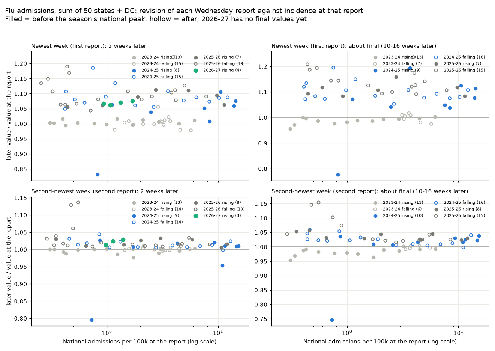
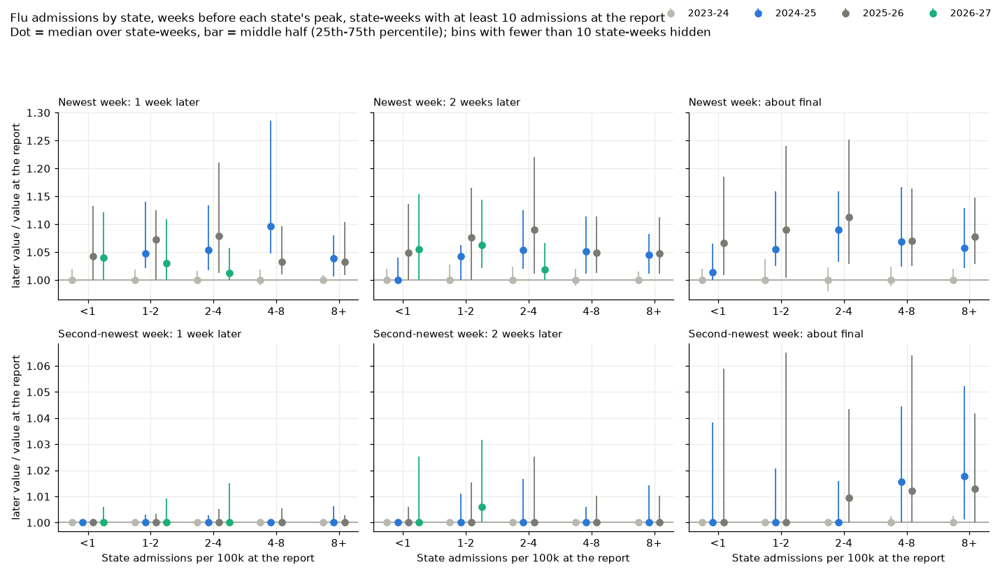
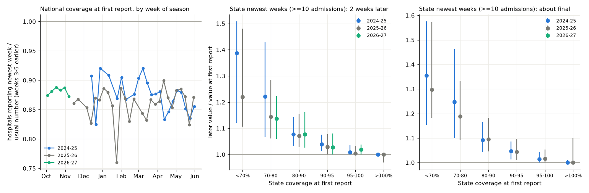
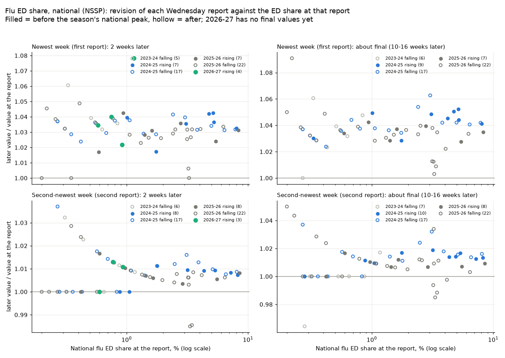

# Reporting delays in 2026-27 compared with earlier seasons at the same incidence

14 November 2026. This page uses data only: no model is trained or scored. It asks whether the flu numbers
first published this season (2026-27) are later revised more or less than the numbers published in 2023-24,
2024-25 and 2025-26. Weeks are compared at the same incidence, not the same calendar date. The question comes
from our forecasts: the model's correction of the newest reported weeks overshoots this season's revisions.

## How to read the numbers

- **Report**: a weekly data release on the FluSight forecast deadline (Wednesday). The **newest week** of a report
  ended the previous Saturday and appears for the first time. The **second-newest week** ended a week earlier and
  appears for the second time.
- **Revision factor**: the week's value in a later report divided by its value in this report. For example,
  ×1.08 means the week ended 8% above what this report showed, and ×1.00 means it was never revised.
  "After 2 weeks" uses the report two weeks later. "About final" uses the first report 10 to 16 weeks later.
- **National admissions** are the sum over the 50 states and DC, without Puerto Rico. **Per 100k** means weekly
  admissions per 100,000 people, using the hub's populations.
- **Rising** weeks are on or before that location's highest week of the season in the latest data of that season.
  **Falling** weeks come after it. 2026-27 has not peaked, so nearly all of its weeks count as rising.
- **Coverage**: the number of hospitals that reported the week in this report, divided by the median number that
  reported the same state 3 to 5 weeks earlier, counted in the same report. It is near 100% once reporting is
  complete. Hospital counts are archived only from November 2024.
- Brackets show the 10th to 90th percentile over reports or state-weeks, and n is their count.

The data sources differ by season. In 2023-24 the values came from the federal hospital reporting system in place
before NHSN relaunched mandatory reporting in November 2024. In 2024-25, 2025-26 and 2026-27 they are NHSN
values. Some reports are missing from the hub's archive: 23 Nov and 7 Dec 2024, 4 and 18 Jan 2025,
everything from 24 Sep to 12 Nov 2025, and 3 Dec 2025. When a report is missing, the matching "after k weeks"
value is blank.

## 1. National admissions: the 2026-27 first reports are revised about as much as in 2025-26

Each row below is one report whose newest week was in the rising phase, with national admissions of about
1 to 3 per 100k at that report. That is the range that 2026-27 has covered so far.

| Season | Report | Per 100k at report | Coverage at report | After 1 week | After 2 weeks | After 4 weeks | About final |
|---|---|---|---|---|---|---|---|
| 2023-24 | 5 reports, 22 Nov–20 Dec 2023 | 1.0–2.9 | not archived | ×1.00–1.02 | ×1.00–1.02 | ×0.99–1.00 | ×0.98–0.99 |
| 2024-25 | 4 Dec 2024 | 1.1 | not archived | – | ×1.063 | ×1.071 | ×1.072 |
| 2024-25 | 18 Dec 2024 | 2.5 | 91% | ×1.034 | ×1.039 | ×1.041 | ×1.041 |
| 2025-26 | 26 Nov 2025 | 0.9 | 87% | – | ×1.061 | ×1.070 | ×1.083 |
| 2025-26 | 10 Dec 2025 | 1.9 | 85% | ×1.062 | ×1.089 | ×1.093 | ×1.108 |
| 2025-26 | 17 Dec 2025 | 2.8 | 83% | ×1.105 | ×1.114 | ×1.144 | ×1.158 |
| 2026-27 | 7 Oct 2026 | 0.9 | 87% | ×1.055 | ×1.067 | ×1.072 | – |
| 2026-27 | 14 Oct 2026 | 1.1 | 88% | ×1.052 | ×1.062 | ×1.089 | – |
| 2026-27 | 21 Oct 2026 | 1.3 | 89% | ×1.054 | ×1.071 | – | – |
| 2026-27 | 28 Oct 2026 | 1.7 | 88% | ×1.055 | ×1.076 | – | – |
| 2026-27 | 4 Nov 2026 | 2.3 | 89% | ×1.043 | – | – | – |
| 2026-27 | 11 Nov 2026 | 2.7 | 87% | – | – | – | – |

- **Newest week, 2026-27 against 2025-26:** in 2026-27 the national newest week ended ×1.06 to ×1.08 above its
  first report two weeks later. In 2025-26, at 0.9 to 2.8 per 100k, the factor was ×1.06 to ×1.11 after two weeks
  and ×1.08 to ×1.16 at about final. Between the two-week mark and about final, 2025-26 reports gained another
  2 to 4%. If 2026-27 follows the same pattern, its newest weeks will end about ×1.08 to ×1.12 above first
  report. That is the same size as 2025-26 at this incidence and not larger.
- **2024-25** revised less (×1.04 to ×1.07 at about final). **2023-24** almost never revised: median ×1.00, and
  its October to December weeks were in fact revised down by 1 to 2%.
- **Second-newest week:** after two weeks, 2026-27 added ×1.014 to ×1.029 to the second report, compared with
  ×1.010 to ×1.033 in 2025-26 and ×1.008 to ×1.026 in 2024-25, all for rising weeks under 4 per 100k
  (2024-25 leaves out the 20 Nov 2024 report, see below).
  At about final, 2025-26 reached ×1.03 to ×1.06.
- **National coverage** at first report was 87 to 89% in every 2026-27 report. In 2025-26 rising reports it was
  83 to 87%, and in 2024-25 it was 83 to 92%. Nationally, this season's first reports are about as complete as
  last season's, or slightly more.
- Checks that match earlier results: the week ending 24 Oct 2026 rose ×1.076 between the 28 Oct and 11 Nov
  reports (+7.6%). Over the 17 reports from November 2025 to March 2026, the median 2025-26 newest week ended
  ×1.117 above first report. An earlier analysis on the 4 Nov panel found ×1.108 for the same thing. It took the
  last value within 11 weeks instead of the first report 10 to 16 weeks later.

*Each dot is one report. The x axis is national admissions per 100k at that report, and the y axis is the revision
factor two weeks later (left) or at about final (right). The top row is the newest week and the bottom row is the
second-newest week. Filled dots are rising weeks and hollow dots are falling weeks. 2026-27 is green and has no
"about final" values yet.*

The falling phase tells the same story. In 2024-25 and 2025-26 the newest week ended ×1.08 to ×1.19 above its
first report at every incidence level. In 2023-24 the same factor was ×0.97 to ×1.01. See `summary.csv` for all
bins. The table leaves out one report: 20 Nov 2024, the first one after NHSN relaunched. Its newest week (0.8 per
100k) was later revised down to ×0.78.

## 2. States: 2026-27 has fewer badly incomplete first reports

The state-level table uses state-weeks with at least 10 admissions at the report, all in the rising phase. Each
cell is the median revision factor of the newest week after 2 weeks, with about final in parentheses. States are
binned by their own admissions per 100k at the report.

| State admissions per 100k at report | 2023-24 | 2024-25 | 2025-26 | 2026-27 (after 2 weeks only) |
|---|---|---|---|---|
| under 1 | ×1.000 (×1.000), n=229 | ×1.000 (×1.014), n=61 | ×1.049 (×1.067), n=73 | ×1.056, n=98 |
| 1–2 | ×1.000 (×1.000), n=106 | ×1.043 (×1.055), n=33 | ×1.077 (×1.090), n=51 | ×1.062, n=50 |
| 2–4 | ×1.000 (×1.000), n=134 | ×1.053 (×1.090), n=35 | ×1.090 (×1.113), n=72 | ×1.018, n=15 |
| 4–8 | ×1.000 (×1.000), n=125 | ×1.052 (×1.069), n=71 | ×1.049 (×1.070), n=57 | ×1.046, n=4 |

In 2026-27, a typical state's newest week is revised about as much as in 2025-26 below 2 per 100k. At 2 to 4 per
100k it is revised less (×1.018 against ×1.090, but only 15 state-weeks so far). The spread is wide in every
season: in 2025-26 the 90th percentile after 2 weeks was ×1.25 to ×1.41. Second-newest
weeks have a median revision of ×1.00 in every season and bin. Their 90th percentile after 2 weeks is ×1.02 to
×1.07 in 2026-27 and ×1.04 to ×1.09 in 2025-26.

*Rising weeks only. The dot is the median over state-weeks and the bar spans the 25th to 75th percentile. Bins
with fewer than 10 state-weeks are hidden.*

### Coverage explains the state differences

Below, each cell is the median revision factor of a state's newest week after 2 weeks, grouped by that state's
coverage at first report. All phases and all states with at least 10 admissions are included. n is the number of
state-weeks.

| Coverage at first report | 2024-25 | 2025-26 | 2026-27 |
|---|---|---|---|
| 70–80% | ×1.222, n=111 | ×1.144, n=195 | ×1.136, n=23 |
| 80–90% | ×1.078, n=347 | ×1.072, n=430 | ×1.077, n=72 |
| 90–95% | ×1.039, n=218 | ×1.029, n=231 | ×1.028, n=34 |
| 95–100% | ×1.008, n=185 | ×1.005, n=185 | ×1.020, n=30 |

- At the same coverage, a 2026-27 first report is revised about as much as one in 2024-25 or 2025-26. Hospitals
  that report late add about the same share of admissions as before.
- What changed is how coverage is distributed. Among rising state-weeks at 1 to 4 per 100k, 8% of 2026-27 first
  reports had coverage below 80%. The share was 28% in 2025-26 and 32% in 2024-25. Coverage of 95 to 100% covered
  20% of state-weeks in 2026-27 and 11% in 2025-26.
- About final, the earlier finding still holds: newest weeks with coverage of 70 to 80% ended ×1.19 to ×1.25
  above first report, and those with 95 to 100% ended ×1.01 to ×1.02 above it (2024-25 and 2025-26).

This fits the overshoot in the model's correction. Late hospitals do not add more this season; instead, fewer
states start with low coverage. About a third of state first reports in 2025-26 had coverage below 80%. A
correction learned there is too large for 2026-27 states that already start at 85 to 95%. Nationally the gap is
small, because national coverage, which the large states dominate, only moved from 83–87% to 87–89%.

*Left: national coverage of the newest week at each report, by week of the season. Middle and right: state newest
weeks grouped by coverage at first report. The y axis is the revision factor after 2 weeks (middle) or at about
final (right). The dot is the median and the bar spans the 25th to 75th percentile.*

## 3. ED share: national revisions are similar, state revisions slightly larger in 2026-27

The data are the NSSP flu share of emergency department visits, in percent. Delphi's archive provides values as
first published from April 2024. The hub's archive provides them from December 2025 and covers 2026-27.

- **National, newest week, after 2 weeks:** 2026-27 reports gave ×1.034, ×1.040, ×1.022 and ×1.078. The ×1.078
  is the week ending 24 Oct, the same week whose admissions rose 7.6%. Earlier seasons, in rising weeks below 2%,
  gave ×1.03 (2025-26) and ×1.03 (2024-25). About final, every earlier season ended ×1.02 to ×1.05 above first
  report at every level.
- **States, newest week, after 2 weeks, rising weeks:**

| State ED share at report | 2024-25 | 2025-26 | 2026-27 |
|---|---|---|---|
| under 1% | ×1.021, n=53 | ×1.026, n=141 | ×1.032, n=158 |
| 1–2% | ×1.029, n=51 | ×1.020, n=60 | ×1.033, n=30 |
| 2–4% | ×1.034, n=85 | ×1.027, n=85 | ×1.043, n=4 |

  So far, 2026-27 state ED shares are revised 0.6 to 1.6% more than in 2025-26. For example, ×1.033 against
  ×1.020 is 1.3% more. That is small next to the admissions revisions.
- **Second-newest week:** ×1.00 to ×1.02 nationally in every season.

## Assumptions

- The hub labels 2023-24 and 2024-25 reports with the Saturday that ends their newest week. I treat each one as the
  data released the following Wednesday. For 2024-25 and later, 99.6% of hub state values equal Delphi's
  archive for that Wednesday.
- NSSP published on Thursdays in 2024-25 and on Tuesdays from mid-2025. Each release that first carries a new week
  counts as that week's Wednesday report. Where both archives exist, Delphi's newest two weeks equal the hub's in
  99.7% of values, and the hub is used.
- Hospital counts come from Delphi's NHSN archive, using one report per week: Wednesday, otherwise Thursday or
  Tuesday when a holiday moved the release.
- Only newest weeks ending October to May are used. "About final" for 2023-24 comes from that season's own
  reports, which end April 2024, so it exists only for reports through mid-February 2024. NHSN's later
  re-publication of 2023-24 is not used.
- Rising and falling are set from each season's latest data. For 2026-27 that is the 11 Nov 2026 report.
- Populations are the hub's single 2026 values for all seasons.
- 2026-27 has only 5 to 6 reports, and its "after 4 weeks" values cover only the 7 and 14 Oct reports. Its
  comparisons will firm up as more reports arrive.

Reproduce with `.venv/bin/python scripts/report_reporting_delays.py` (about 10 seconds). The script prints every
table on this page. `summary.csv` holds the binned medians for national admissions, state admissions and national
ED share.
