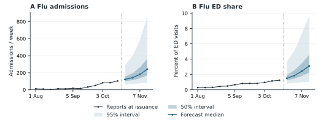

# Chromantis

Chromantis is a forecasting system for infectious diseases. Every week it predicts how many
people will be admitted to hospital with influenza or RSV, and what share of
emergency-department visits those diseases will account for, for each US state, DC and
the country, over the next few weeks. It also forecasts the size and timing of the flu season's
peak, local flu activity in about 100 US areas, and confirmed cases in the 2026 Bundibugyo
Ebola outbreak in the Democratic Republic of the Congo. COVID-19 models exist but are still at
the research stage.

The forecasts are public. Each week they go to forecast hubs, shared repositories where many
teams submit forecasts of the same targets so they can be scored side by side, under the name
ACCIDDA-Chromantis.

**The hard part is the data.** Hospitals and surveillance systems publish reports at different
times, leave gaps and revise past values. A low count in the latest report may reflect a
decline in illness, unfinished reporting, or both. A model has to learn from that imperfect
history, and anyone evaluating it has to reconstruct what it could have known at the time.

**New here?** [What we learned](findings.md) gives the main results in plain language, with
how sure we are of each. Forecasts for each disease are under the challenges below.

## Challenges

-   **[FluSight weekly](challenges/flusight-weekly.md)**

    ---

    Flu hospital admissions and ED share, states, DC and US, 0–3 weeks ahead.

    *Submitting.* B7 mixture, 30 fits. Last: 31 October 2026.

-   **[FluSight season peak](challenges/flusight-peak.md)**

    ---

    Size and week of the 2026–27 flu admission peak, in the FluSight file.

    *Submitting.* Peak8, 6 fits. Last: 31 October 2026.

-   **[RSV Forecast Hub](challenges/rsv.md)**

    ---

    RSV hospital admissions and ED share, states, DC and US, 0–3 weeks ahead.

    *Submitting.* Four-recipe mixture, 40 fits. Last: 31 October 2026.

-   **[Flu MetroCast](challenges/metrocast.md)**

    ---

    Local flu ED percentage in 103 health service areas and cities, 0–3 weeks and full season.

    *Submitting.* 4-week and full-season models spliced. Last: 31 October 2026.

-   **[COVID-19 Forecast Hub](challenges/covid.md)**

    ---

    COVID-19 hospital admissions and ED share, states, DC and US.

    *Research only.* Six provisional candidates, none submitted.

-   **[BDBV Modeling Hub (Ebola)](challenges/ebola.md)**

    ---

    Confirmed Bundibugyo Ebola cases in the DRC by onset week: nowcast and 1–4 weeks ahead.

    *Submitting.* Nowcast plus 12-fit ensemble. Last: 31 October 2026.

All submissions are listed on [Challenges](challenges/index.md).

## Reading a forecast

The black points show North Carolina's influenza reports available on
21 October 2026. The blue line and bands show the median and central 50% and
95% prediction intervals for the four weeks beginning 24 October. The first
week is a *nowcast*: its outcome was still unreported when the forecast was
issued. The widening bands express the model's uncertainty about later weeks.

Admissions are weekly counts. The ED series measures the proportion of all
emergency-department visits attributed to influenza; the figure displays it as
a percentage. Both outcomes measure healthcare use, which also depends on care
seeking, testing and reporting practices.

The forecast combines three neural model configurations, with ten fits per
configuration. Each fit used a different random seed and trained on 2022–23
through 2025–26 flu admissions and ED histories. Reporting errors measured in
2025–26 made those training inputs resemble preliminary reports. The models
learned to predict future reference admissions and ED shares from the September
2026 snapshot. For this 2026–27 forecast, saved correction trees adjusted the
two newest observed weeks before the saved neural models read the 21 October
reports. The models kept their trained weights. The figure shows the issued
forecast; its future outcomes are not scored here.

## Where to go next

| You want to | Go to |
|---|---|
| Read the main results in plain language | [What we learned](findings.md) |
| See what is submitted and what each model reads | [Challenges](challenges/index.md) |
| Understand how the model works, with diagrams | [Architecture](architecture.md) |
| Look at the source data and how reports change | [Data](data/index.md) and the [availability staircase](data/staircase.md) |
| Check the evidence behind a choice | [Model runs](experiments/index.md) |
| See how a question becomes a submitted forecast | [Workflow](reusable-research-workflow.md) |
| Install the package, run commands or change the code | [Software](development.md) |

The [repository](https://github.com/ACCIDDA/chromantis) holds the source code, problem
definitions and release manifests.
